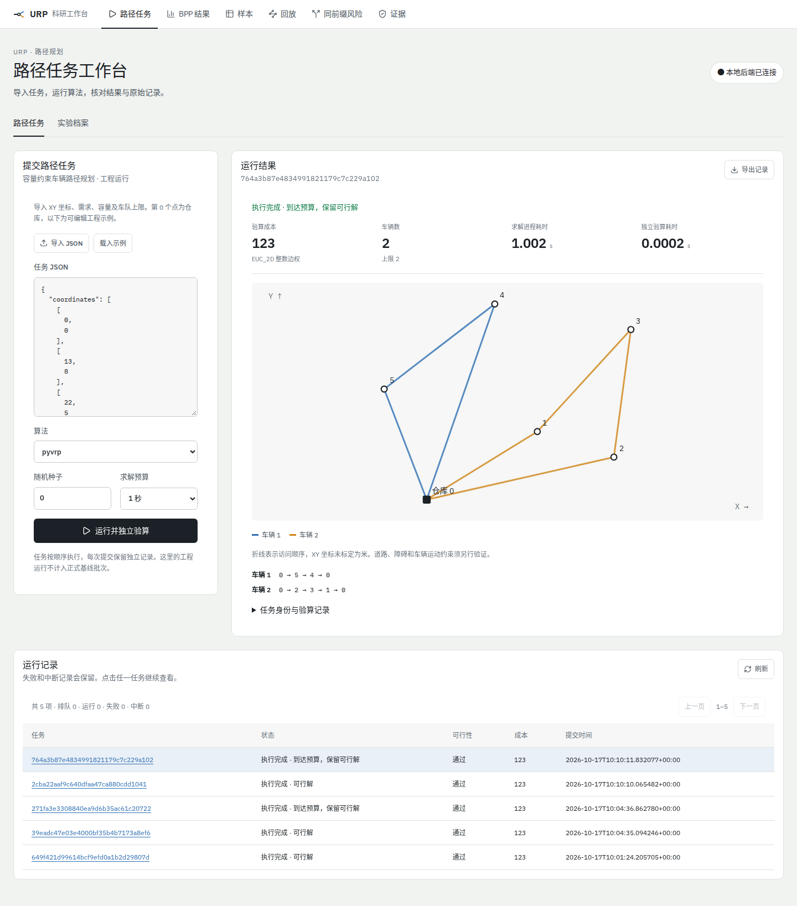

# URP 与仿真系统审查、修复和验收

日期：2026-10-17。

本轮完成了项目自有实现的系统审查、实际修复和工程验收：新增可真实执行的路径任务工作台，强化独立验算、失败记账、运行数据库和进程监督，接入固定版本的官方 TurtleBot 4 仿真入口，并重新读取全部 4,505 项 CVRPLIB 主基线记录。**15 个工程门槛全部通过，包含 451 项自动化测试；另有 12 项浏览器检查通过。** 详细结果分别保存在[工程证据](verification/20261017/engineering/summary.json)、[浏览器证据](verification/20261017/browser/summary.json)和[归档重审](../protocol/audits/20261017/README.md)。

最影响研究结论的发现是：既有路径质量和分母能够复现，但部分主机/运行环境证明链没有完整归档。修复后的统计只将满足身份与哈希核验条件的记录列为“已验证同主机、同资源批次”对照。物理仿真仍有真实运行环境和任务闭环的缺口，本轮没有把软件测试通过写成机器人任务成功。

## 1. 审查范围与基底

初始 `main` 为 `50b3b2c2cc7377e1f13dcaeebce09abf5619dbf8`。审查发现 `cvrp-baselines` 已有较新的算法库、完整基线和历史目录，最终采用其 `0a41a895373f786b983c871a359b65fc553d7710` 作为交付比较基底，保留这部分已完成研究。

| 范围 | 本轮实际工作 |
|---|---|
| 全仓目录 | 盘点较新基底的 26,457 个跟踪文件，确认数据、原始包、研究实现、界面、后端、机器人包与历史入口的关系 |
| 自有实现 | 重点审查 `src/backend`、`src/frontend`、`src/research`、`src/robotics`、`protocol`、`independent`，并检查根启动、构建和验证入口 |
| 历史研究证据 | 读取三个主结果压缩包的全部 4,505 个终态，重算路线、参考解和可计分差距；另复核 BPP 冻结导出和轨迹证据 |
| 仿真 | 检查现有场景合同、反馈时间戳、启动/退出和验收判定；核对并适配官方上游的固定入口；实际执行离线预检 |
| 75 个外部论文项目 | 盘点来源与项目定位；没有逐仓运行、训练或逐行审计第三方的全部代码 |

工程检查覆盖本项目当前可执行的研究与系统边界。4,505 项求解实验没有重新跑一遍；新的工程示例也没有混入正式实验分母。原始归档、历史报告和冻结基线数据保持原有字节，新增结论写入独立审计目录。

## 2. 已完成的实现改进

### 2.1 路径任务工作台与后端

新增 `#/jobs` 页面，形成真实的“输入 → 排队 → 求解 → 独立验算 → 路线展示 → 导出记录”流程。页面支持编辑或导入 CVRP JSON、选择已安装的受控算法、设置种子和预算，刷新后继续查看同一任务。所有已接收任务都有唯一身份和终态记录，分页及状态计数覆盖全部任务。

本期页面提供 `savings / T / TRS / TSR / pyvrp` 五个工程入口，PyVRP 要求当前解释器安装匹配的 0.14.0。其他正式配置继续由研究 CLI 使用。任务有 2–300 节点、1 秒或 5 秒预算等明确限制，既不接收任意脚本，也不把页面任务自动加入正式基线。[接口、输入合同和状态说明](../src/backend/docs/JOBS_API.md)给出了完整约束。

后端为每次尝试保存输入、场景版本、算法、种子、预算、源码及依赖身份、独立 checker 结果和执行时间。相同场景版本对应不同输入会返回冲突；源代码在服务存活期间变化会阻止混用版本。服务重启将未完成任务记为 `interrupted`，不隐藏中断或用新的尝试覆盖旧记录。

数据库初始化现在使用只读 SQLite 备份，把历史库复制到独立运行库，正确包含 WAL 中已提交内容。已有运行库不被替换，多个同时启动的进程也不会互相覆盖。接口加强了 JSON 重复键、非有限数、布尔值伪装整数、路径、媒体类型、请求来源和版本一致性检查。浏览器开发与生产预览通过同源受限代理访问真实后端。

界面区分“进程结束”“数学上有合法解”和“没有验算结果”，不把未知成本显示为零。XY 图使用一致比例绘制输入节点和返回路线，归档路线保留完整、部分、无效和无解状态。移动端检查覆盖 390 像素宽度，以及展开长 JSON 证据后的布局。

### 2.2 研究代码、独立验算与失败记账

| 原有风险 | 修复后行为 |
|---|---|
| turn_modes 中同一路网节点的多个客户可能被单任务索引覆盖，布尔值可混同节点整数 | 按客户/任务 ID 分别保留服务任务，严格检查 ID、需求、容量、车数和路线 |
| 空方案、缺失客户、无法到达等情况解释不一致 | 候选独立验算失败即保留失败，缺少解不解释为数学不可行证明 |
| 单点或重合坐标引发零除和非有限特征 | 特征输出显式处理退化输入，并检测有限数 |
| 成功记录驱动聚合，坏 JSON 或未启动项可能消失 | 以冻结计划键为完整分母，异常、中断、缺少输出和未启动分别记账 |
| CRC/评分参数与性能单元不够严格 | 校验有限损失、合法参数、重复种子/单元；对提供 `base_id` 或 `parent_instance_id` 的清单执行跨分区检查，缺少时回退 `instance_id`，仍需补齐并核查底本标识 |
| 结果自报主机信息直接进入已验证统计 | 必须核对最近 VERIFIED manifest、计划哈希和所指环境文件，声明冲突或近层未验证不能继承认证 |
| 命令失败、缺少评价文件仍可能退出 0 | 公共 CLI 将执行与验算失败传递为失败退出，并保留证据 |

研究验收规则见[研究合同](../src/research/docs/RESEARCH_ACCEPTANCE.md)。除了单元测试，还独立校验了 80 个合成问题中的 10,864 个局部移动，并对 1,080 个固定顺序问题比较 Split 与穷举结果；这些属于数学实现检查，不是新的性能优越性实验。

### 2.3 仿真采用上游复用路线

沿用项目[路径研究与仿真方案](路径研究与仿真方案.md)，新增官方 TurtleBot 4 Humble 1.0.3 参考适配，固定提交为 `0ea4a60c51e49ed4a9e25b4f9971ff0f0c9a08fe`。关键 launch、spawn、bridge、世界文件和包信息核对到六个 Git blob 身份。入口直接包含上游 Lite 机器人与 Depot 世界，没有继续扩建自造温室。来源、参数和启动方式见[上游接入说明](../src/robotics/docs/UPSTREAM_REFERENCE.md)。

现有仿真测试设施修复了重复反馈时间戳、错误坐标系、非整数纳秒、场景版本/单位、缺少标定、启动和 bridge 失败、进程退出但缺少验收报告等问题。ROS domain 使用执行锁隔离，验收输出必须写到新目录；离线 wheel 构建和配置/语法检查通过。

**当前云端是 Ubuntu 24.04，缺少 ROS 2 Humble、`ros2`、`ign`、ament 和图形会话。** 官方上游与现有测试设施的预检都实际返回退出码 2，并记录 `runtime_executed=false`。本轮没有执行 ROS/colcon 集成构建、RViz、Gazebo 物理运动、Nav2 或农业任务。机器人核心 56 项测试验证的是合同和逻辑。

Depot 是参考世界，上游 Fuel 模型 URL 尚未冻结到完整资产版本；配置保留 `asset_versions_frozen=false`、`full_dependency_lock=false`。导航、定位和 SLAM 默认关闭。还需要在匹配环境中完成地图标定、服务位姿、任务执行器、取消/超时、物理反馈和独立轨迹评价，才能验收实际仿真任务。

### 2.4 可复现启动和持续检查

工程环境新增 Python 3.12 与 `uv.lock`，固定 numpy、jsonschema 及可选 PyVRP/OR-Tools 版本，前端继续使用 npm 锁文件。原始基线的 `requirements.lock` 保留，新的工程环境不替代旧实验身份。

`tools/check_project.py` 统一执行 15 个门槛，每次创建新证据目录，保留失败、退出码、耗时、日志和 SHA-256。监督器清理进程组及脱离会话的子进程后才计算日志哈希；空测试输出不能算通过。新增 GitHub Actions 使用同一检查命令，并上传完整检查目录。远端运行结果以具体提交关联的 Actions/Checks 为准，本目录保存的是本地实际验证记录。

## 3. 历史 CVRPLIB 结果：质量复现，主机统计降级

完整方法、分算法数据、原始文件哈希与中断关联见[审计说明](../protocol/audits/20261017/README.md)和[机器可读报告](../protocol/audits/20261017/archive_review.json)。独立审计不导入求解器，从原始坐标以 Decimal 80 位精度复算 EUC_2D 整数边长、容量、车数、客户访问、截止前候选和参考解。

| 指标 | 重审结果 |
|---|---:|
| 主基线计划 | 17 配置 × 53 问题定义 × 5 种子/计时重复 = 4,505 项，每项 5 秒预算 |
| 不同基础坐标/需求实例 | 51 |
| 唯一终态 / 未启动 / 重复 / 计划外 | 4,505 / 0 / 0 / 0 |
| 可行 / 没有有效解 | 4,316 / 189 |
| 全部尝试 | 4,509，包括四个有原始 claim 关联的基础设施中断与后续重试 |
| 参考解复验 / 差距复算 | 53 / 4,316 |
| 路线审计错误 / 可行性分歧 | 0 / 0 |
| 与原 4,505 行质量结果 / 289 组描述性汇总差异 | 0 / 0 |

四次初始中断没有可恢复路线、分数或时长，不能填造数据，也不能把计划分母增加到 4,509。另一个 120 项 vendor 对照独立保留，本轮主归档重审不把它混入 4,505。

主机证据分三类：901 条 cloud seed0 有 VERIFIED、计划与环境文件哈希链；901 条 cloud seed2 缺少这条完整核验链；2,703 条本机记录有与结果绑定的 FROZEN 资源声明，但原汇总引用的主机/环境核验包装文件没有归档。后两类仍可保留已核对的路线质量和相应资源声明。

| 统计解释 | 原数量 | 当前完整核验链支持 |
|---|---:|---:|
| 已验证同主机、同资源批次、相同算例/种子的算法差距配对行 | 31,512 | 6,618 |
| overall 算法 × 资源批次 CPU 均值组 | 89 | 17 |

其余 24,894 个差距配对行和 72 个 CPU 组应降为未完成归档核验的描述性观测，补齐原证明文件前不能标为已验证同条件对照。其中差距配对衡量路线质量，CPU 组描述耗时，两者不能混称为速度配对。“已验证”指归档身份/哈希关系，不是物理硬件的独立鉴定。证据不足不证明路线成本或主机声明为假。

这批实验支持容量约束多点路径分配的质量描述，不能直接支持农业避障、运动学、覆盖完整性或物理跟踪成功率，也不构成在线智能推荐已经完成的证据。既有数据中 41 个 small 问题来自 A/B/E/F/P 家族，6 个 medium 与 6 个 large 全来自 X，规模与家族混杂；确定性配置的五次计时重复也不是五个独立随机搜索样本。不能据此直接宣称独立的规模/分布效应或统计显著性，详见[冻结基线](../experiments/baselines/cvrp/README.md)。

## 4. 实际验证与证据索引

### 工程门槛

| 门槛 | 结果 |
|---|---:|
| 后端单元测试 | 94 / 94 |
| 真实历史包导入与附件一致性 | 1 / 1 |
| 真实 HTTP route-scene 合同 | 1 / 1 |
| 研究包 | 113 / 113 |
| 生成器 | 12 / 12 |
| 执行监督 | 25 / 25 |
| 基线聚合协议 | 13 / 13 |
| 独立验算与归档审计单元测试 | 23 / 23 |
| 公共 CLI、运行库初始化与检查监督 | 19 / 19 |
| 机器人核心与适配逻辑 | 56 / 56 |
| 前端数据测试 | 28 / 28 |
| 前端 UI 单元测试 | 17 / 17 |
| 前端逐步回放测试 | 49 / 49 |
| BPP 科学读回 | PASS |
| TypeScript 与生产构建 | PASS |

13 个测试门槛共 451 项测试；加上 BPP 科学读回和前端构建，共 15 个门槛。原始日志与清理状态保存在[engineering](verification/20261017/engineering/summary.json)。历史包集成检查覆盖 5 包、690 项指标、28 个附件；route-scene 集成检查覆盖 14 场景、60 次真实 HTTP 请求和 5 种状态。

BPP 科学读回覆盖 264 个输入、768 个运行、3,840,000 步轨迹、120 个 selector 决策、264 个前缀、4 个风险组、18 个确认单元、10,000 个已存 bootstrap 重复、1,914 个 manifest 条目及 284 个冻结哈希。四项科学检查均通过。这是对既有结果的重放和独立读回，没有新训练、新采样或新的长预算实验。

### 浏览器与中间失败记录

生产预览和真实后端完成 12 项检查，包括两次实际六节点求解、独立验算、编辑输入产生新身份、刷新恢复、下载、跨来源请求拒绝、非法输入不入队、历史状态呈现，以及桌面和手机布局。两个工程样例分别执行 savings 与 PyVRP，结果均有合法路线；它们不是统计性能对照。

分页和终态标签使用明确标记的 101 行拦截响应夹具，未将假任务写入数据库。归档状态使用明确的合成场景夹具。最终记录明确区分这些夹具与真实 HTTP/求解检查。

第一次浏览器检查发现算法选择框缺少可访问名称；修复后通过。随后人工查看展开证据的移动布局，补充最小宽度约束和对应检查，再次全部通过。为保留过程，三轮摘要都归档：首次失败 [run1](verification/20261017/browser/run1-summary.json)、第二轮 [run2](verification/20261017/browser/run2-summary.json)、最终 [summary](verification/20261017/browser/summary.json)。



[390 像素移动端截图](verification/20261017/browser/mobile.png) · [实际导出任务](verification/20261017/browser/downloaded-job.json) · [环境版本记录](verification/20261017/environment.json) · [源文件与证据哈希](verification/20261017/SHA256SUMS.json)

本地验收使用 Python 3.12.14、Node 24.19.0、uv 0.12.23、PyVRP 0.14.0。锁定 Playwright 所需浏览器下载返回空压缩包后，改用官方 Chrome for Testing 的 headless-shell 155.0.8059.84 完成检查；来源和实际二进制哈希已记录。

## 5. 复现命令

在 Linux 仓库根目录准备 Python 3.12、Node.js 24 与 uv 0.12.23，然后执行：

```sh
bash tools/setup.sh --extra solvers
bash src/start.sh bootstrap
bash src/start.sh build
```

两个终端分别运行：

```sh
bash src/start.sh backend
bash src/start.sh frontend
```

打开 <http://127.0.0.1:4173/#/jobs>。默认运行库为 `.local-state/research.sqlite3`；后端端口默认 4180。端口、解释器和运行库覆盖方式见[主 README](../README.md)。

```sh
# 每次生成独立工程检查目录
bash src/start.sh check

# 全部 CVRPLIB 归档只读重审；输出必须是新文件
.venv/bin/python independent/audit_archives.py --output /tmp/urp-archive-review-new.json

# 仿真离线预检；输出必须是新目录
cd src/robotics
../../.venv/bin/python scripts/check_upstream.py --output-dir evidence/tb4-preflight-new
```

浏览器独立检查的运行方式、临时数据库与夹具边界见[前端文档](../src/frontend/README.md)。官方仿真启动命令仅在[目标依赖与预检](../src/robotics/docs/UPSTREAM_REFERENCE.md)满足后使用。

## 6. 对研究目标的完成度与下一验收点

| 目标 | 当前状态 | 下一步必须拿到的证据 |
|---|---|---|
| 统一算法库与评价 | 现有 17 个 CVRP 配置与冻结主基线已保存，独立 checker 和计划分母强化；不等同全局/局部规划等全部算法任务已交付 | 按农业任务补齐或明确算法范围；新算法/修改版本另立计划，报告全部失败和同条件对照，不能改写冻结基线 |
| 用户场景到实际求解 | 五个入口的数值任务可在页面真实运行并保留记录 | 将农业任务定义、服务约束和尺度来源纳入有版本的场景输入 |
| 智能推荐 | 现有离线推荐/CRC 研究代码；当前页面由用户手动选择算法 | 受约束候选清单、可核验特征、推荐与执行的独立身份、拒绝/回退；按底本隔离训练、校准、测试 |
| 仿真接入 | 固定上游入口、离线预检、严格合同；物理运行未完成 | 匹配 ROS 环境的真实加载、依赖/资产冻结、标定地图、任务执行器、独立物理反馈和服务事件 |
| 农业案例与论文结论 | 数学路线实验可复算；不等于田间执行 | 预先定义的农业任务、失败和未服务分母，规划路径与实际轨迹分开，按观测能力报告碰撞/完成率 |

本轮没有部署在线 LLM 推荐服务，也没有启动微调、算法生成或新的训练。现阶段更需要完成受约束推荐与真实任务执行的证据链；软件著作权、专利等行政成果另按项目要求准备，不能由代码测试替代。

## 7. 方案参考文献校正

检查项目方案引用时发现部分示例 arXiv 编号指向无关论文，建议后续正式方案引用下面的原始来源，避免把链接占位符写入论文：

| 名称 | 正式来源 | 说明 |
|---|---|---|
| AlphaEvolve | [arXiv:2506.13131](https://arxiv.org/abs/2506.13131) | `2501.12345` 实际是天体力学论文 *The doubly librating Plutinos* |
| FunSearch | [Nature: s41586-023-06924-6](https://www.nature.com/articles/s41586-023-06924-6) | `2205.00527` 实际是数论论文 *On Finite Analogs of Schmidt's Problem and Its Variants* |
| LLM4AD | [arXiv:2412.17287](https://arxiv.org/abs/2412.17287) · [官方仓库](https://github.com/Optima-CityU/llm4ad) | 平台与资源集合应区分；本轮没有训练或复现该平台全部算法 |

这些文献支持方法背景，不替代本项目自己的算法运行、推荐校准和仿真验收。
