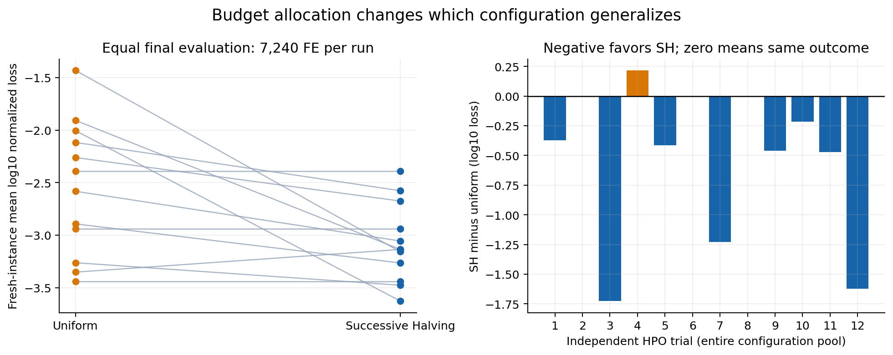
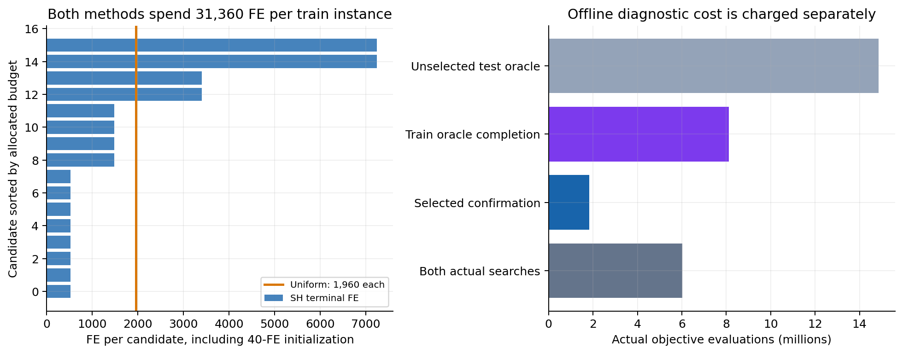
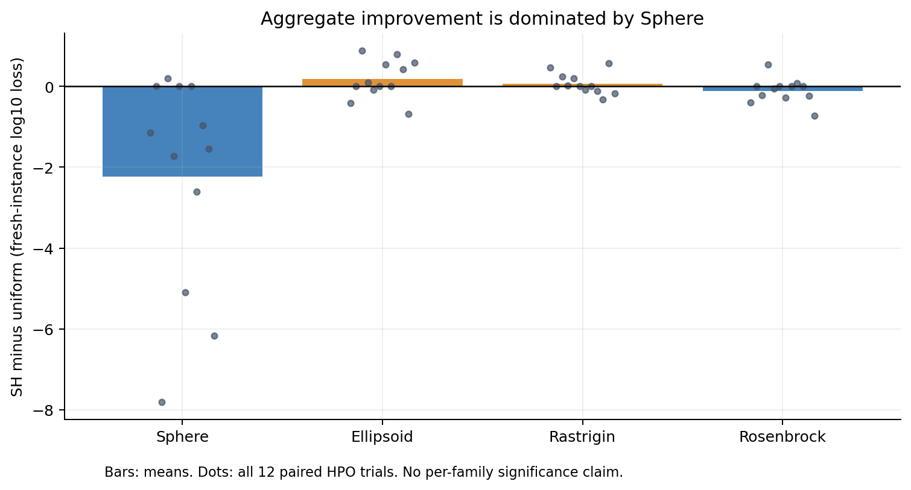
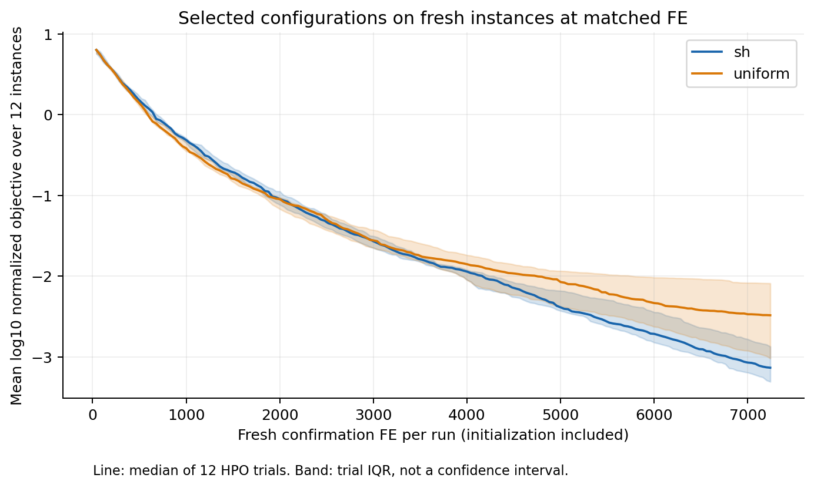
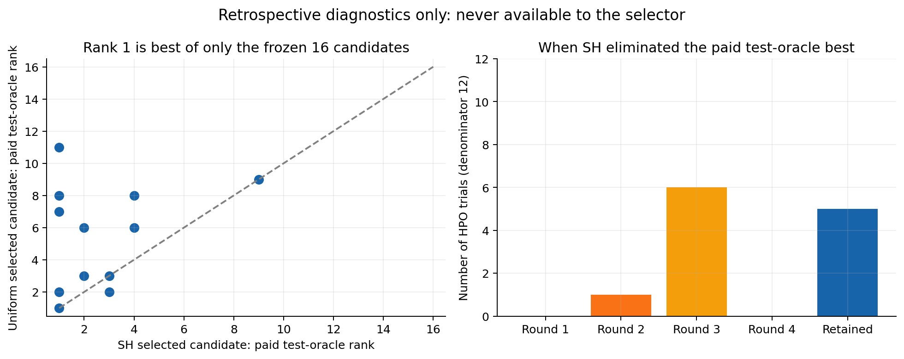

# Successive Halving预算机制的DE任务迁移复验

2026年10月6日 UTC。独立新增CPU实验。本文检验M06论文的真实预算分配机制，不是作者代码、原论文整表或BBOB复现。

## 主要结论

在12次完整、配对、独立候选池的调参试验中，SH与均匀分配的搜索FE严格相同。两者选出的配置随后从头运行于新的实例和RNG，均获得7240FE。SH相对均匀分配的“确认实例平均log10归一化损失”差值均值为 **-0.5244**，预设20000次成对bootstrap的95%百分位区间 **[-0.9006, -0.1932]**。12个调参块的SH胜/同/负为 **8/3/1**，精确双侧符号检验p=0.03906。

每块先计算SH/均匀分配的归一化几何平均损失比，再对12块取中位数，得到 **0.4052**；小于1有利于SH。该量不是原目标的算术平均下降率，也不是求解速度倍数。区间和p值只描述本预设合成任务分布，不支持一般算法或新任务域的普适优越性。

总体差值主要由Sphere推动：四族平均log10差分别为Sphere −2.2385、Ellipsoid +0.1801、Rastrigin +0.0686、Rosenbrock −0.1077。因此Ellipsoid与Rastrigin的平均结果反而较差，不能把总体比值当作各类任务都改善。

全候选付费补跑显示：SH在2/12个候选池淘汰了最终7240FE训练面板第一名；在7/12个池淘汰了事后7240FE确认面板第一名，其中0/12发生在第一轮。这说明有限低预算筛选仍可能丢掉最终好配置。离线第一名来自额外全候选测量，绝不是已部署选择器或真实全局最优。

## 论文来源与复验位置

核心机制来自Jamieson与Talwalkar的Non-stochastic Best Arm Identification and Hyperparameter Optimization。项目M06/P344精读使用arXiv:1502.07943v1（2015，13页），本轮重新核对公开2016 PMLR正文第4页Figure 3：预算按轮数及存活候选数均分，新增训练资源后按累计损失保留一半，直到一个候选。来源：[PMLR论文页](https://proceedings.mlr.press/v51/jamieson16.html)。P246 [Hyperband](https://jmlr.org/papers/v18/16-558.html)的精读用于检查启动成本、低保真错序与资源定义边界，本轮没有执行Hyperband多bracket。

把这套机制迁移到DE参数配置时，资源是目标函数评价数FE，臂是固定F、CR配置，损失是当前8个训练实例上的聚合优化误差。DE当前最优值有界且单调，但本次终点是预定7240FE；没有证明未知收敛包络、原论文充分预算条件或独立实例泛化保证。训练实例上的排序和新实例确认性能是两件事。

旧独立DE包做的是9网格对9随机静态调参、D=10/N=50、三个未变换函数、216 run。本次新建D=12/N=40、四类变换实例、12个全新随机配置池以及磁盘续训状态。旧方案和结果用于避免重复，未用于后验挑本次函数/候选/seed；因研究背景可见，本次称独立开发确认，不称完全盲测。旧代码与132/60生成协议均未修改。

## 事前冻结的设计与成本

- 12个独立调参试验，每试验16个独立均匀随机候选：F∈[0.2,1.0]，CR∈[0.1,1.0]。全部具体数值和RNG种子写入plan.json后才开始正式评分。
- D=12，N=40，同步DE/rand/1/bin，供体互异且排除目标；强制至少一个坐标交叉；逐坐标clip至[-5,5]；严格改善才替换。固定结构，不是新算法发现。
- 四函数族：平移Sphere、平移Rastrigin、平移旋转条件数10000的Ellipsoid、平移Rosenbrock。每试验每族2个训练实例及3个新确认实例，合计8/12。平移在[-1,1]内事前产生，最优值均0；只旋转Ellipsoid。
- 各候选、各方法对同一实例使用完全相同的初始种群和PCG64算子流；不同试验/实例/确认阶段使用独立命名RNG域。候选参数不改变随机数消耗。
- 全部16候选各支付40FE初始化。SH四轮每个存活候选新增480/960/1920/3840FE，存活数16/8/4/2，累计520/1480/3400/7240FE。新增资源每轮7680FE，初始化640FE，总31360FE/训练实例。
- 均匀分配各候选1960FE，包括40FE初始化；16×1960=31360FE。每种方法每次调参8×31360=250880FE，12次各3010560FE。
- 选择分数固定为8实例的log10(max(归一化最优误差,1e-12))算术平均，同分按候选ID。归一化是解析常数：Sphere及Rastrigin除以12，Ellipsoid除以权重和，Rosenbrock除以101×11。没有按观测最小/最大值归一化，没有使用确认或oracle校准阈值。
- 所有12次、两种方法的选择先写入结果文件并做SHA256封存，之后才开始新实例确认。随后所有淘汰配置按原状态补到7240FE，以及所有未选配置在确认实例跑满7240FE，仅作付费诊断。补跑不反向改变任何选择。
- 两方法若选择同配置，确认实际执行一次并记录双角色别名；不会把别名当独立样本。调参训练本身两方法独立实际执行，不使用离线曲线模拟分配。

| 计算阶段 | 实际FE | CPU秒（分段内含保存） |
|---|---:|---:|
| Both actual searches | 6,021,120 | 27.55 |
| Selected confirmation | 1,824,480 | 7.04 |
| Train oracle completion | 8,110,080 | 32.34 |
| Unselected test oracle | 14,856,480 | 57.83 |
| 正式实验合计 | 30,812,160 | 127.30 |

正式实验墙钟127.33秒。非评分测试21720FE、0.127 CPU秒。独立审计另有695,040FE直跑重放，不反馈优化器；审计总CPU 27.87秒、墙钟27.89秒。此外审计独立公式重算样本点和保存种群，不属于优化器FE但确实消耗CPU，已包含在审计耗时。数值运行采用单进程/原生单线程，未调用LLM、远程评价API、付费服务或安装依赖。绘图与归档是后处理，另行记录。

FE相同不等于端到端墙钟相同。本目标函数非常廉价，归档压缩和框架开销可能大于函数本身；不可从本实验推导昂贵训练的速度倍数。选择观测次数SH为每试验30次聚合评分、均匀为16次；它们读取已有最优值，不新增FE。初始化、排序和序列化CPU已在实际执行中发生。

## 完整12块结果

负差值有利于SH；比值是SH/均匀的归一化几何平均损失；排名依赖额外全候选确认，不能上线使用。

| 试验 | SH配置 | 均匀配置 | 配对log10差 | 配对比值 | 事后确认排名 SH/均匀 |
|---:|---|---|---:|---:|---:|
| 1 | c02 | c13 | -0.3721 | 0.4245 | 2 / 3 |
| 2 | c11 | c11 | 0.0000 | 1.0000 | 3 / 3 |
| 3 | c01 | c12 | -1.7258 | 0.0188 | 1 / 11 |
| 4 | c13 | c10 | 0.2159 | 1.6441 | 3 / 2 |
| 5 | c07 | c05 | -0.4136 | 0.3858 | 4 / 6 |
| 6 | c09 | c09 | 0.0000 | 1.0000 | 9 / 9 |
| 7 | c08 | c05 | -1.2280 | 0.0592 | 1 / 8 |
| 8 | c00 | c00 | 0.0000 | 1.0000 | 1 / 1 |
| 9 | c03 | c13 | -0.4597 | 0.3470 | 4 / 8 |
| 10 | c14 | c08 | -0.2142 | 0.6106 | 1 / 2 |
| 11 | c00 | c11 | -0.4732 | 0.3364 | 2 / 6 |
| 12 | c12 | c05 | -1.6217 | 0.0239 | 1 / 7 |

按函数族的以下分解为预设四族的描述性结果；没有分别做显著性结论或筛掉较差函数。每族分母仍是12个完整调参块，而非把36个实例当独立调参试验。

| 函数族 | 平均SH减均匀log10差 | SH胜/同/负 |
|---|---:|---:|
| sphere | -2.2385 | 8 / 3 / 1 |
| ellipsoid | 0.1801 | 3 / 3 / 6 |
| rastrigin | 0.0686 | 4 / 3 / 5 |
| rosenbrock | -0.1077 | 6 / 3 / 3 |

曲线对每试验先在12个新实例上平均log10损失，再取12试验中位数；色带为试验间四分位，不是置信区间。曲线显示部署所选配置在相同FE的行为；不能把训练期长跑与短跑末值直接比较来声称选参优势。

## 误淘汰与离线诊断

原始候选池中第一轮520FE排名与7240FE训练排名、训练第一名淘汰轮次、确认第一名淘汰轮次、两选择的最终有限池排名均在analysis.json和CSV内。可能存在低预算慢起步，也可能存在训练到新实例的排序变化；本实验没有把二者混成同一种失败。确认oracle同时包含实例随机性与固定有限候选池选择的乐观偏差，因此只报告风险诊断。

低预算相关性再高也不构成无误淘汰证明。SH最终胜过或落后均匀分配，并不改变该限制。尚未比较Hyperband保守bracket、不同最小资源、更多训练实例或SMAC/irace；不能根据此结果事后挑一个更好早停方案再复用相同确认面板。

## 完整性与核验

12个完整调参试验全部完成；每种方法1536条训练轨迹、两方法合计3072条；确认全矩阵2304条，合计5376条真实逻辑轨迹。SH多次恢复使实际保存分段为8064个，分段不是新的独立run。失败、非有限值、超时、删除、替换均0。所有事前分母保留。

- 12项非评分合同测试通过：解析值、供体互异排除目标、非法预算、磁盘恢复后逐代值/点hash/样本/种群/fitness/RNG与直跑精确一致。
- 8064个分段逐一核SHA、评价数量、FE连续性、保存人口/最佳点、单调最优曲线、每代最小与均值、RNG前后衔接。
- 770,304个预设每代1-of-40样本点用标准库标量目标公式重新计算；最大max(1,abs(value))缩放误差为2.64e-15。另外重算每段40个最终个体，共322,560点。样本检查不是全坐标点重算。
- 对全部1536条SH训练轨迹，补跑完整前1960FE的每代所有评价值、整批点SHA及曲线，与均匀臂独立执行前缀逐项精确匹配。
- 对事前约定的12个SH赢家×8训练实例共96条轨迹，从初始seed直跑7240FE，逐代全部值、整批点hash和曲线与磁盘多段续训精确匹配，共695,040审计FE。
- 从原始曲线另行重算两方法全部淘汰与赢家；确认选择SHA不变；全部统计以完整调参块为单位重算。原DE文件hash不变。

独立指另一套标量公式、账本与统计检查，加上可重复直跑；并不表示由外部研究团队完成。记录保存全部FE值、每代曲线、每代固定样本点、每批点hash和续训状态，未保存每个坐标点。冻结源与种子可重建整条轨迹。

## 独立审阅

另一位审阅者未导入core.py，独立重写DE并完整重放同96条赢家轨迹，逐代匹配通过；同时核查全部分段、选择、统计与24份原始ZIP。结论为PASS_WITH_SCOPE_LIMITATIONS，完整意见见review/M06_AUDIT_ZH.md。其额外695040FE重放和16.31CPU秒单列，不与前述作者自检混算。独立审阅确认所有正式FE目标值均未触及事前1e-12下限。

## 可复核文件与使用边界

plan.json给出所有配置、实例变换、种子、指标、预算与失败处理；prerun_freeze.json列正式前代码SHA。src/包含冻结、核心DE、运行、审计、后处理。results/ledger.jsonl是实际调用账本，selection.json是确认前锁定选择，confirmation_aliases.json记录重复角色，analysis.json/CSV与audit.json保存汇总及验证。data/*.npz使用NumPy allow_pickle=False读取，含每阶段原始值和checkpoint。figures/含PNG、SVG及曲线数据。

重跑须解压到新目录并更换或另存results/data输出，原运行器会拒绝覆盖既有账本。不要修改plan后仍称同一预注册复验。这里只使用固定四函数族、一个维度、一个预算、12候选池和有限F/CR空间；新实例确认是同分布变换，绝非未见函数族、噪声、工程任务、算法结构发现或农业可行性证据。

计划SHA256：aca0081e0010c70d80828d1b18c33d0961ddff9745ee9544adb2316af4129bfa。选择SHA256：aacf6dea17064951969a0b042577471d031dd3dc943f46c770b94e75a8ee3267。审计SHA256：6cc56462781c31ba19a32ba45201c4f960e62baf17fd49f0c27674345e5e11ef。
