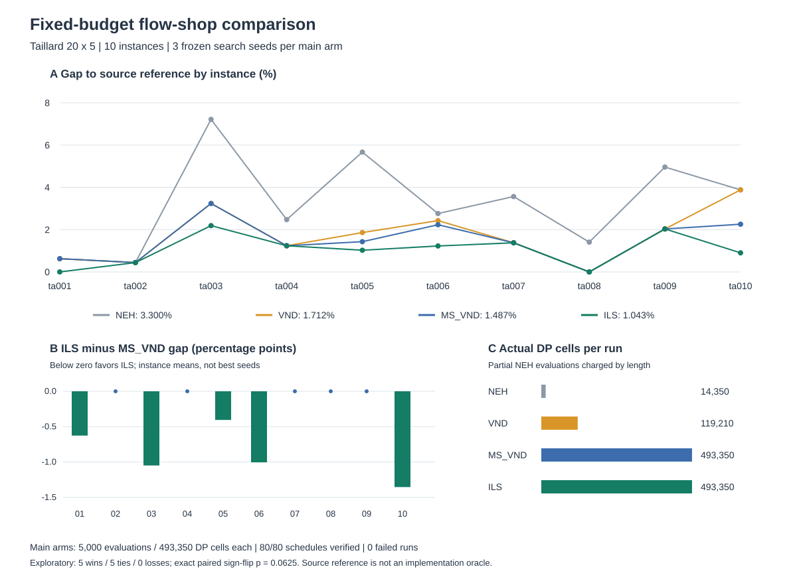
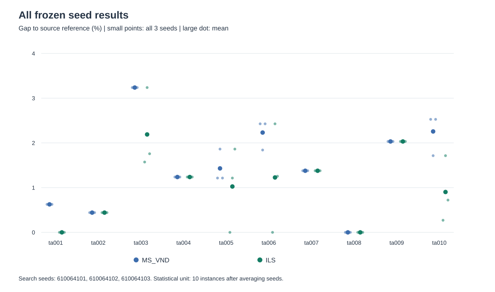
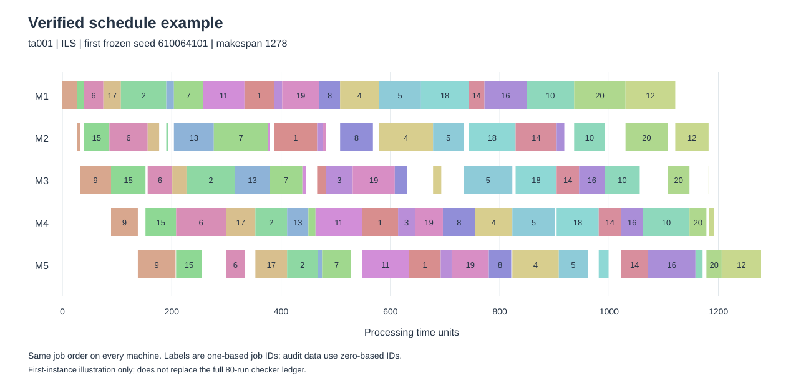

# FSSP固定扰动ILS与多起点VND实验报告

## 结果摘要

预定80次运行全部完成并留下记录；80/80个最终排列通过独立时序验收，共核对8000道工序。每个主比较run都用满5000次候选评价、493350个DP单元更新。先在每实例内平均3个冻结seed，再跨10实例平均，多起点VND的来源参考gap为1.4871%，固定双交换ILS为1.0434%。ILS在实例均值上5胜、5平、0负，平均改善0.4437个百分点。

这是一个小规模、固定预算、固定机制的组件实验。配对精确符号翻转双侧p=0.0625，未达到常用0.05阈值。结果支持继续研究该机制，不能宣称统计显著的普遍优势，也不能称完整EoH复现或P5全部完成。

## 研究来源与执行范围

[EoH论文](https://proceedings.mlr.press/v235/liu24bs.html)附录PDF21–23页的D.2/D.3、图10和表12提供FSSP任务接口、Swap/Relocate邻域及手工ILS对照的依据。原论文生成启发式会改动搜索用时间矩阵和扰动工件；本轮不生成启发式、不改时间矩阵，只实现固定NEH、VND、多起点和双交换ILS，用于验证独立任务宿主及其固定机制。这里的ILS是预先自定规则，不等同于论文ILS1或ILS2。NEH依据[Nawaz、Enscore、Ham 1983](https://doi.org/10.1016/0305-0483(83)90088-9)。

数据来自[Taillard作者索引](https://mistic.iict-heig-vd.ch/taillard/problemes.dir/ordonnancement.dir/ordonnancement.html)、[20×5实例原文](https://mistic.iict-heig-vd.ch/taillard/problemes.dir/ordonnancement.dir/flowshop.dir/tai20_5.txt)和[参考界文件](https://mistic.iict-heig-vd.ch/taillard/problemes.dir/ordonnancement.dir/flowshop.dir/best_lb_up.txt)。原文按机器为行，已显式转为工件×机器矩阵。10组共1000个加工时长整数均在1–99内；首个实例首工件时长为[54,79,16,66,58]。原文件、读取时间和SHA256均保存。

来源参考文件标题为Update : 03.06.2026。前10参考值依次为1278、1359、1081、1293、1235、1195、1234、1206、1230、1108；报告仅称“来源参考值”。实例文本原header保留历史上界，其中ta005=1236、ta007=1239，与当前来源参考1235、1234不同。参考值仅在solver返回后计算gap，不向优化器传入，不作提前停止、调参或结果选择依据。

整个实验在独立云端目录和stdlib venv内运行，没有LLM调用、作者程序执行、Codex任务或全局依赖变更。没有接触旧holdout和正在进行的bin-packing实验。

## 冻结设计与预算

- NEH参考：按工件总加工时间降序构造，相同总时长按工件ID升序；遍历插入位置，等值取最早位置。每run共210次部分或完整候选评价、14350个DP单元更新。
- VND参考：从NEH起点开始，swap后relocate，字典序遍历，接受首个严格改善，改善后返回swap。两个邻域均扫描完成且无改善才记录局部最优。
- 多起点VND主臂：第一起点同NEH+VND，此后均匀随机打乱全部工件，反复VND到预算。
- 固定ILS主臂：第一起点同NEH+VND；抽取4个不同位置，做两次不相交swap，再VND；局部最优不劣于当前时接受，等值允许漂移，否则拒绝。全程保留原始矩阵上最好的已完成完整候选。
- 搜索seed在首次正式运行前固定为610064101、610064102、610064103；NEH/VND各10run，两主臂各30run，合计80。没有换seed、补样或按命中参考值提前停止。
- 每run上限5000次候选、500000个DP单元、3秒CPU、8秒wall。每次评价先扣预算；长度k的排列按k×5计DP单元，避免把NEH部分排列当完整排列同价。CPU/wall每次评价前检查，另有wall信号中断；本批均在0.085秒内结束，未触及时间边界。
- 总正式上限400000次候选、40000000 DP单元、240 CPU秒、640 wall秒，不含预检、checker、I/O和分析。所有80run串行，计算单进程。

## 全部实例结果

表中两主臂为3个seed的makespan均值；NEH和VND各一个确定性结果。所有比较均使用10实例为统计单位。

| 实例 | 来源参考 | NEH | VND | 多起点VND均值 | ILS均值 | ILS−多起点 gap百分点 |
|---|---:|---:|---:|---:|---:|---:|
| ta001 | 1278 | 1286 | 1286 | 1286.000 | 1278.000 | -0.6260 |
| ta002 | 1359 | 1365 | 1365 | 1365.000 | 1365.000 | 0.0000 |
| ta003 | 1081 | 1159 | 1116 | 1116.000 | 1104.667 | -1.0484 |
| ta004 | 1293 | 1325 | 1309 | 1309.000 | 1309.000 | 0.0000 |
| ta005 | 1235 | 1305 | 1258 | 1252.667 | 1247.667 | -0.4049 |
| ta006 | 1195 | 1228 | 1224 | 1221.667 | 1209.667 | -1.0042 |
| ta007 | 1234 | 1278 | 1251 | 1251.000 | 1251.000 | 0.0000 |
| ta008 | 1206 | 1223 | 1206 | 1206.000 | 1206.000 | 0.0000 |
| ta009 | 1230 | 1291 | 1255 | 1255.000 | 1255.000 | 0.0000 |
| ta010 | 1108 | 1151 | 1151 | 1133.000 | 1118.000 | -1.3538 |

图1：上方展示10实例的四方法gap；左下展示主比较的实例差；右下展示实际DP单元。四方法参考比较与两主臂等预算比较应区分解读。

| 方法 | runs | 平均gap | 每run平均候选 | 每run平均DP单元 | 每run平均CPU秒 |
|---|---:|---:|---:|---:|---:|
| NEH | 10 | 3.3003% | 210.0 | 14,350 | 0.002257 |
| VND | 10 | 1.7123% | 1258.6 | 119,210 | 0.016569 |
| MS_VND | 30 | 1.4871% | 5000.0 | 493,350 | 0.068657 |
| ILS | 30 | 1.0434% | 5000.0 | 493,350 | 0.068916 |

NEH和单次VND自然结束，计算量较少，只作为参考，不把它们与主臂的差异归因于同预算机制。两主臂每run的候选数及DP单元完全一致。多起点VND平均启动2.4次随机重启，ILS平均启动3.833次扰动；主臂预算限制了可完成的搜索轮数。

## 随机重复与探索性统计

图2：展示所有60个主臂结果，小点为三个冻结seed，大点为实例内均值。均值优势不等于每个seed都改善，例如ta005和ta006各有一个配对seed下ILS更差。相同seed只是重复索引，两种算法消耗随机流的方式不同。

主比较ILS−多起点VND的平均gap差为-0.443722个百分点，中位数为-0.202429个百分点；对应makespan差平均为-5.133。10实例的胜平负为5/5/0。预先规定的1024种符号组合精确配对检验双侧p=0.0625。固定seed的10000次实例级bootstrap给95%百分位区间[-0.761147, -0.145327]个百分点。

这个bootstrap区间不跨0，而精确检验未达到0.05：两者使用不同的小样本假设和离散程度，不能挑有利的指标宣称“显著”。此处仅10个固定小规模实例，其中5个差值为0；更可靠的外推需要预先规划的新实例、更大规模和更多重复，本批不追加选择性试验。

ILS有8/30个run等于来源参考，多起点VND有3/30个；这只是来源参考命中统计，不能代替求解器正确性证明或自行升级成已证明最优。

## 实现验收与完整时序

正式运行前，4个独立新6工件×3机器案例各枚举720个排列，共2880个完整排列；求解器DP与独立checker构建时序逐个一致。四例精确穷举makespan分别为97、89、87、84。另外验证手工3×2算例makespan=11、NEH计费、邻域覆盖与VND局部最优、1000次双交换恰好改动4个位置、候选/DP/CPU/wall扣费边界，以及11个非法排列、矩阵、makespan和时序负向案例。

正式完成后独立checker从落盘矩阵和排列重建所有start/end，校验工件唯一、加工时长、工序前后约束、同机器不重叠、机器共用排列和makespan。80/80通过，时序共8000条。全部80个完整排列和其时序随包提供；没有只检查最优run。预检与checker的计算另记，不冒充正式搜索预算。

图3：仅取第一个实例、第一个冻结ILS seed说明时序结构；图内为1-based工件ID，机器可存在空闲。短工序为可见窄条但不强塞标签；所有工序ID及精确start/end见verified_schedules.jsonl（0-based ID）。示例图不替代80个run的全量验收。

## 独立审阅结论

第二套独立复核另读原始1000个加工时长，以二维完成时间表重算80个makespan和8000道工序，核验17个冻结文件SHA、5700个VND终点邻居、4×720个小例及115条扰动RNG记录，未发现影响结果的实现或记账问题。复核未调用solve，也未重跑正式run；审计CPU约0.292秒，另于搜索预算。完整结论见AUDIT_INDEPENDENT.md与JSON。

验收仍有明确边界：没有逐候选完整轨迹，审计不能单凭日志追溯证明每次历史评价；CPU在评价前软检查，异步wall信号竞争路径未做压力测试。本批全由候选预算终止，计费数等于完成数，未触发这些边界。

## 资源与状态记录

- 实际正式搜索：314,686次候选，30,936,600个DP单元，CPU合计4.315428秒，逐run wall合计4.315846秒
- 最大单run CPU 0.084875秒、wall 0.084887秒
- 预检：CPU 0.233007秒，wall 0.233032秒
- 独立时序checker：CPU 0.014660秒，wall 0.014673秒
- 20个参考run自然结束；60个主run均以candidate_budget正常截断并保存有效best。失败0个，丢失0个，重复run ID 0个
- CPU/wall是本机短任务观测值；I/O、分析与作图不在上述正式搜索时长内，不据此判断稳定速度排名

## 可复核交付与下一步

本地交付包含PLAN.md、config.json、FREEZE.json、原始官方文本及解析证据、纯标准库求解器与独立checker、预检结果、80run账本、8000道工序时序、逐实例统计CSV/JSON、三张科研图的SVG/PNG及本报告。完整结果由manifest逐文件SHA256绑定。

当前组件已完成预定验证。适合后续预先规划的方向，是在更大Taillard组和更多固定seed下检验是否仍有均值改善，并决定是否接入受预算约束的生成启发式接口；本轮没有擅自扩大数据集或开始生成搜索。原EoH/P5主线的完成状态应继续单独验收。
