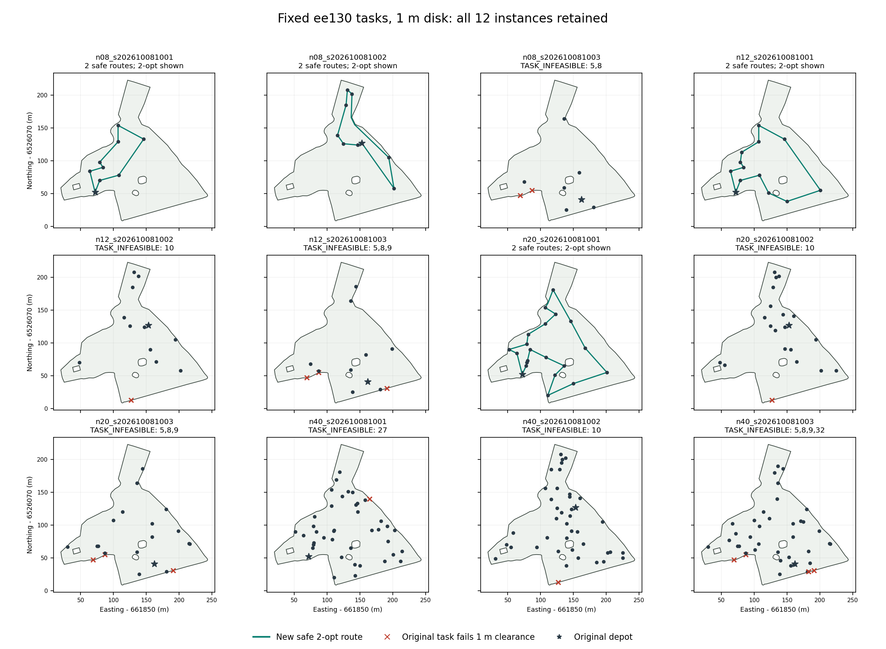
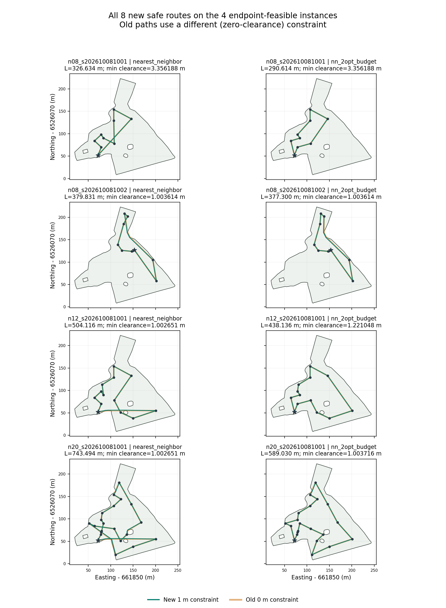

# ee130 固定任务的 1 米净空规划验证

日期：2026-10-08。独立新阶段，沿用原地块、任务和各自 depot，未重采样或挪动任何点。

## 结论

原 12 个实例全部保留：8 个实例有原任务点本身不足 1 米净空，记为 TASK_INFEASIBLE，未求路线；其余 4 个实例分别得到 NN 和固定预算 2-opt 共 8 条数值几何可行路线。不能把这 4 个实例说成全部任务都通过。

8 条新路线完整折线的最小计算净空为 **1.002651196 米**（作者 GEOS）；独立精确有理复核约为 **1.002651194998 米**，均在原地块内，避开原 3 个孔洞，闭合返回原 depot，且每项任务有且仅有一次计划服务访问。本文的“安全路线”只指冻结圆盘模型和保存坐标上的数值几何验证，不表示真实农机可执行。

原来 1 米审计已经通过的 3 条路线保持原长度；另 5 条旧路线虽不满足 1 米净空，本阶段找到了满足检查的新连接线。旧路线不安全不能证明没有安全路径。8 个任务点不可行的实例则不能仅改连接线修复。

独立保存结果审阅已正式通过，详见文末；原始产物的 COMPLETE_UNAUDITED 标签永久保留以记录交付顺序。

## 冻结方法

- 原实例：任务数 8、12、20、40，各配 3 个原种子 202610081001、202610081002、202610081003；每种子的 4 个规模是嵌套前缀，不是 12 个独立地块样本。
- 几何：字节不变的原 EPSG:32634 米制 WKT，原外环和 3 个孔洞。沿用作者投影用法不等于确认测绘真值。
- 足迹：预先指定半径 1 米的平移圆盘，没有方向、姿态、最小转弯半径、速度、动力学或农具铰接模型。
- 候选中心区域：GEOS 负 buffer，每象限 16 段；距离固定为 (1 + 0.00001)/cos(pi/32)，约 1.004849 米。膨胀和余量在真实数据执行前固定，未为得到阳性结果调整。
- 不把 buffer 本身当成保证。对整个填充区域重新检查原地块包含、距原边界超过 1 + 1e-8 米，以及与每个原孔洞不相交。本次得到 1 个组件、仍有 3 个孔洞，整个中心区域最小数值净空 1.002265584 米。
- 对中心区域全部顶点建立 visibility 图，复用原距离与闭域可见性函数，每条接受边还检查原地块和原边界净空。共享图为 455 节点、27,531 条边。
- 服务点连接及 Dijkstra 只构成有限图路径；其他服务点不作为腿内部的中转图节点。NN 和 first-improvement 2-opt 函数与旧代码逐字相同；2-opt 上限 10,000 个反转候选，无改善整轮可提前结束。未运行新的精确最优 oracle。

该离散构造只用于找候选解，没有声称精确连续最短路。保守区域排除某些安全端点、有限图断联，都不能证明连续域原任务不可行。本次未出现这两种状态，也没有临界或技术失败状态。

## 全部 12 个实例

种子后缀 1001、1002、1003 在下表分别表示完整种子 202610081001、202610081002、202610081003。任务 ID 沿用原输入，0 为 depot。

| 任务数 | 种子后缀 | 状态 | 不可行原任务 ID | 最小服务点净空 米 |
|---:|---:|---|---|---:|
| 8 | 1001 | 两条路线数值几何通过 | 无 | 3.356188 |
| 8 | 1002 | 两条路线数值几何通过 | 无 | 2.581799 |
| 8 | 1003 | TASK_INFEASIBLE | 5, 8 | 0.469372 |
| 12 | 1001 | 两条路线数值几何通过 | 无 | 3.356188 |
| 12 | 1002 | TASK_INFEASIBLE | 10 | 0.487298 |
| 12 | 1003 | TASK_INFEASIBLE | 5, 8, 9 | 0.282354 |
| 20 | 1001 | 两条路线数值几何通过 | 无 | 1.381114 |
| 20 | 1002 | TASK_INFEASIBLE | 10 | 0.487298 |
| 20 | 1003 | TASK_INFEASIBLE | 5, 8, 9 | 0.282354 |
| 40 | 1001 | TASK_INFEASIBLE | 27 | 0.218844 |
| 40 | 1002 | TASK_INFEASIBLE | 10 | 0.487298 |
| 40 | 1003 | TASK_INFEASIBLE | 5, 8, 9, 32 | 0.282354 |

所有 depot 通过。不可行任务的距离远离 1e-8 米临界带，未通过四舍五入把临界值算作通过。

## 路线代价与净空

旧路线在零净空约束下构造；本阶段约束已改为 1 米，因此新旧长度差不是纯算法提升。以下显示全部 8 条新路线，不只挑较短或较好看的结果。

| 实例 | 方法 | 旧长度 米 | 旧路线 1 米审计 | 新长度 米 | 新最小净空 米 |
|---|---|---:|---|---:|---:|
| n08 s1001 | NN | 326.634109 | 通过 | 326.634109 | 3.356188300 |
| n08 s1001 | 2-opt | 290.614111 | 通过 | 290.614111 | 3.356188300 |
| n08 s1002 | NN | 379.180899 | 不通过 | 379.830999 | 1.003614402 |
| n08 s1002 | 2-opt | 376.480740 | 不通过 | 377.300401 | 1.003614401 |
| n12 s1001 | NN | 503.918377 | 不通过 | 504.116133 | 1.002651196 |
| n12 s1001 | 2-opt | 438.136067 | 通过 | 438.136067 | 1.221047943 |
| n20 s1001 | NN | 741.580183 | 不通过 | 743.493918 | 1.002651196 |
| n20 s1001 | 2-opt | 588.905032 | 不通过 | 589.030025 | 1.003716429 |

只在本阶段同一图、同一约束内比较，2-opt 相对 NN 的长度下降依次为 11.0276%、0.6662%、13.0883%、20.7754%。反转候选数分别为 81、49、168、713，均提前达到无改善完整扫描。这是本样本上的启发式改善，不是最优性证明或统计显著性结论。

另外 16 个“实例 × 方法”组合明确未求解，因为所属原任务实例端点不可行；对应旧长度仍完整保留在 all_24_method_conditions.csv。

## 后验验证与解释边界

对每条完整折线及其全部线段均检查原田块内包含和到原外环及全部孔洞边的最小距离；没有只检查端点或抽样点。GEOS 最小距离与 Decimal 60 位投影和相交计算交叉核对；包含性另以原 WKT 十进制和已保存路线十进制的 Fraction 谓词检查。完整路径长度与距离矩阵代价一致，任务服务顺序恰一次、depot 闭合、各原孔洞不相交均记录在逐路线审计 JSON。

访问一次指计划服务事件一次。路过某个任务坐标不自动算作重复作业；本实验没有作业时序和控制执行模型。

通过阈值为包含且距离 > 1 + 1e-8 米；距离 < 1 - 1e-8 或出界判失败；落在临界带则保持 uncertain。最小路线余量仅约2.65毫米，整个中心区域的最小余量约2.27毫米，仅防止本次坐标和数值计算贴阈值，绝不涵盖 GNSS 误差、地块测量误差或控制误差。部署前仍需另建实际车辆与不确定性模型。

## 成本和执行顺序

唯一正式执行的总 wall 时间 13.8025 秒、CPU 时间 13.7891 秒，峰值 RSS 63,696 KiB。限制为 300 秒 CPU、600 秒 wall、1 GiB 地址空间，共享阶段 240 秒、单实例 60 秒。未重试或调参。

共享中心区域及可见图预处理 8.0655 秒。4 个可规划实例的额外图预处理 wall 时间依次为 0.4406、0.4832、0.6873、1.1687 秒；每个 NN/2-opt 调用均小于 0.3 毫秒。因此不能只报告微秒级启发式求解时间，把几何构图成本隐去。求解 CPU 计时分辨率产生 0 值，不表示零计算成本。

逐点和逐段验证使用缓存，其次序相关耗时与共享构图、实例构图、启发式求解分开保存。本实验没有做重复计时，不能据此得出稳定速度结论。报告绘图及独立复核不计入上述正式实验运行时间。

顺序可审计：原净空正式独审 PASS → 本阶段冻结 54 项文件和合成 toy 测试 → 127,068 字节 PREEXEC 私有备份回读 → 唯一正式执行 → 911,922 字节未审 raw 私有备份回读 → 解释与独立保存结果审阅。原审计和本阶段原始数据未覆盖。

## 独立审阅状态

保存结果独立审阅正式 PASS：125,709 项检查通过，零失败。审阅器不导入作者代码，直接读取原 WKT 与已保存 JSON 的十进制值，以精确整数和有理数重新计算相交、绕数包含、全部原边界最小距离平方和阈值。123 个独特服务点、161 次线段使用及 92 条独特线段均核验；与作者距离最大差为 6.5015e-10 米，小于冻结的 1e-8 米容差。全部 12 实例状态、任务服务恰一次、depot 闭合、三孔、图与矩阵、已保存 NN 决策、2-opt moves 及预算、哈希和资源均通过。独立复核用时约 1.49 秒，不重新规划。

独审同样只针对保存十进制几何，不证明真实测绘精度、车辆动力学或全局连续最短路。完整报告与独立审阅源码收录在 independent_review/。

## 文件索引

- freeze/PROTOCOL.json 和 PREEXECUTION_FREEZE.json：冻结设计、参数、资源限制及哈希
- input/：全部原输入、旧长度结果、原净空审计结论；freeze/INPUT_IDENTITY.json 逐一证明原文件字节一致
- raw/results.json：全部 12 实例、全部状态及资源
- raw/shared_preprocessing.json 和 center_region.wkt：完整候选区域及共享图
- raw/*_graph.json：可规划实例的完整矩阵、路径及新增图边
- raw/*_solver_output.json 与 *_route_audit.json：8 条路线的求解输出和逐段后验审计
- reports/all_24_method_conditions.csv：24 个方法条件完整代价和状态
- reports/all_12_instances.png：保留不可行实例的完整面板
- reports/all_8_safe_routes.png：全部新路线和旧路径的同图对照
- evidence/：备份回读门控、运行状态和图片说明

PREEXEC 包 SHA256：81c128aab379c4e0ecd3e3d0841c382899b6a678bacb474277567c8ff1b9eb12。

未审 RAW 包 SHA256：fd8c3d35da50d9fa8c3df88abf2bd426c22b797e4a6c10c70c2acdc387878d4d。
