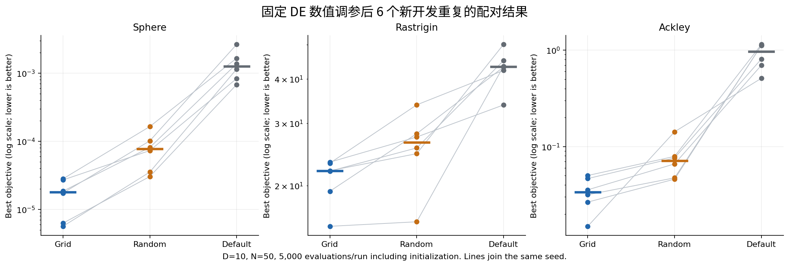
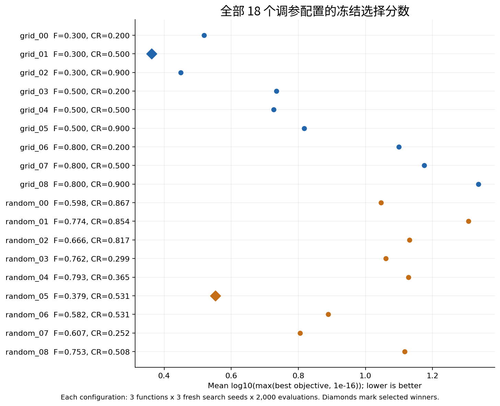
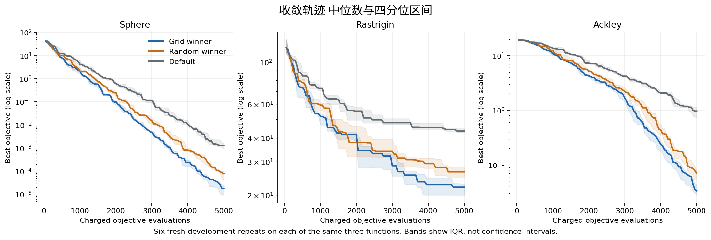

# 固定 DE 的等预算数值调参实验

2026 年 10 月 6 日 UTC。教师 P1 与独立 DE 扩展的新增开发实验。

## 主要发现

固定 DE/rand/1/bin 结构不变，分别用 9 组网格参数和 9 组连续随机参数进行等成本搜索。每臂 162000 次目标评价。网格选中 F=0.3、CR=0.5；随机选中 F=0.379266339619164、CR=0.531407633292614。冻结赢家后，以 6 个未用于选优的新开发种子，在原来的三种函数上与默认 F=.5、CR=.9 配对比较。

两种调参赢家在各函数均 6/6 次优于默认。本轮网格赢家也在 18 个函数与种子配对中全部优于随机赢家。这是这个固定 DE、限定参数区间和本轮开发面板上的结果；不能据此判定网格搜索普遍优于随机搜索。只有一份随机搜索参数集，没有重复整个调参过程。

| 函数 | 网格赢家最终值中位数 | 随机赢家最终值中位数 | 默认最终值中位数 |
|---|---:|---:|---:|
| Sphere | 1.7941002e-05 | 7.7158781e-05 | 0.0012631276 |
| Rastrigin | 22.009463 | 26.485524 | 43.311067 |
| Ackley | 0.033586424 | 0.071125318 | 0.96392549 |

以下比值先对同种子的“调参赢家值 / 默认值”计算，再取 6 个比值的中位数。它不是上表两个中位数之比。小于 1 表示更好。

| 函数 | 网格比值中位数 | 随机比值中位数 | 网格胜默认 | 随机胜默认 |
|---|---:|---:|---:|---:|
| Sphere | 0.0113295 | 0.0518072 | 6/6 | 6/6 |
| Rastrigin | 0.467083 | 0.607896 | 6/6 | 6/6 |
| Ackley | 0.0363979 | 0.0814661 | 6/6 | 6/6 |

Rastrigin 网格中位数仍为约 22.01，远高于已知全局最优 0，因此这里的改善不等于已可靠求得全局最优。所有结果、包括较差配置，都保留在逐 run 账本。

## 与教师要求及论文的关系

教师 P1 的真实目标函数与计数器来自 function_optimization/src/baselines.py。DE 真实入口来自 function_optimization_de/src/de.py；源码原样复制，并保留其通过 parents[2] 定位相邻目录的结构。固定实现为同步 DE/rand/1/bin，供体排除目标且互异无放回，交叉强制至少一个坐标，逐坐标 clip，严格改善才替换。

LLaMEA-HPO 论文 [In-the-loop Hyper-Parameter Optimization for LLM-Based Automated Design of Heuristics](https://arxiv.org/abs/2410.16309) 讨论将结构生成与数值参数搜索分开。这里只借用这一分账思路，验证固定结构的数值调参组件。未执行作者 LLaMEA-HPO、SMAC 或 LLM 程序，未做结构发现、BBOB 或整篇论文复现。P252 的本地源码核查说明与教师核查说明仅作为方法来源，不能当作已经运行作者完整代码的证据。

## 运行前冻结的设计

- D=10，N=50；Sphere/Rastrigin 坐标边界 [-5.12,5.12]，Ackley [-32.768,32.768]
- 网格：F∈{.3,.5,.8} × CR∈{.2,.5,.9}，9 配置
- 随机：同区间连续均匀独立抽 9 配置；具体双精度数值在 plan.json，运行前已冻结
- 每配置 3 个新开发种子 × 3 函数 × 2000 次评价，各搜索臂 162000 评价
- 每臂按 mean(log10(max(best_f,1e-16))) 在 9 个函数与种子块上选择一个全局配置；同分按冻结配置 ID 升序
- 选优记录及 SHA256 写出后，再在另外 6 个新开发种子 × 3 函数 × 5000 评价上比较两位赢家和默认，总复评 270000 评价
- 配置身份相同则物理执行去重并留别名。本次两位赢家与默认互不相同，实际 216 run = 名义 216 run，实际 594000 评价 = 名义 594000 评价
- 各配置在每一函数/种子使用相同初始种群与相同 PCG64 算子随机流；不同阶段种子互不重合
- 新 RNG 域为 dot.independent.de-hpo.component.20261006.v1。种子由命名标签的 SHA256 前 8 字节按小端生成；所有数值种子及规则见 plan.json
- 没有读取旧结果/data 文件或历史/holdout 种子文件。方法准备阶段读过来源核查与 README 的相关说明，已有方法背景可见，所以本实验明确称开发验证，不称盲测
- 第一组结果严格取冻结顺序中的 Sphere / 第一个搜索种子，全部 18 个配置均公开。合成单元测试使用独立测试输入与种子，不属于研究面板

该选择分数是不同函数原始误差的对数平均，跨函数的量纲与尺度解释有限；它只是预定的选优规则。没有以复评数据重选参数，也没有事后更改调参预算。

## 成本与运行隔离

全部实验在独立目录和无 pip 的 venv 内执行，只读复用已安装 NumPy 2.3.5，没有安装/升级全局依赖，没有修改原 P1/DE，也未调用模型、用户电脑或其他任务执行环境。计算阶段单进程、原生线程上限 1；信号硬墙钟 300 秒，外层 timeout 305 秒作为后备。

实测含测试、保存和选择的执行墙钟 8.463590 秒、CPU 8.457724 秒；其中 run_de 数值阶段墙钟 6.965324 秒、CPU 6.960899 秒。独立审计另用墙钟 2.347308 秒、CPU 2.345629 秒。绘图为计算结束后的展示步骤，只读使用已安装 matplotlib 3.10.8，缓存放在本目录；没有改变计算环境。

| 成本项目 | run 数 | 优化器目标评价 |
|---|---:|---:|
| 网格调参 | 81 | 162000 |
| 随机调参 | 81 | 162000 |
| 网格赢家新开发复评 | 18 | 90000 |
| 随机赢家新开发复评 | 18 | 90000 |
| 默认新开发复评 | 18 | 90000 |
| 合计 | 216 | 594000 |

默认参数本身没有额外选择成本；它在网格中作为 grid_05 的测量已计入网格调参 162000 成本。调参方案的前期 162000 成本不能在最终赢家与默认的 5000 评价比较中被隐去。本实验没有证明端到端成本一定值得。

此外合成单元测试 25 次目标评价；审计另行独立重算 594000 个记录候选和 216 个最优点。这些检查没有反馈给优化器，不计入 594000 次优化搜索预算，但真实计算成本已单列。无失败、无截断、无删除或替换 run。

## 独立核验

12 个运行前合同测试全部通过，覆盖三个已知最优点/非零手算值、非法边界/非有限值、预算拒绝、DE 强制交叉与裁剪手算、初始化收费与精确耗尽预算。

运行后审计不导入可信优化器及目标函数，而按 Python 标准库标量数学公式独立计算所有保存候选。3997 项检查全部通过；最大目标绝对差 8.52651e-14，最大按 max(abs(y),1) 缩放差 5.10703e-15。另核验：每 run 预算/边界/初始化哈希，全部轨迹最优/批次最小/均值，最优点与账本对应关系，相同初始和最终随机流状态，搜索/复评种子分离，去重别名，选择前输入哈希，冻结代码哈希，并独立重算两臂赢家。

这里的“独立”指另一套标量目标公式和账本检查逻辑，不表示由独立研究团队完成。配对随机流的审计验证其开始/结束状态一致，未保存每一个供体索引，但所有实际被评价候选均留存。

曲线为每函数 6 个新开发重复的中位数；浅色带是四分位区间，不是置信区间。初始 50 次评价计入横轴。没有显著性检验或把 18 个函数与种子块当作 18 个独立函数。

## 可复核材料

- plan.json 与 prerun_freeze.json：配置、种子、预算、选择规则与运行前源码哈希
- sources/：未修改的真实入口与计数依赖；provenance/：来源说明与环境
- src/freeze.py、run.py、audit.py：冻结、真实运行与独立核验代码；src/make_report.py：运行后展示代码
- results/runs.csv、runs.json、runs.jsonl：216 个实际 run 的指标、参数、预算、CPU/墙钟、最优点及原始数组哈希
- results/runs/*.npz：全部候选点、原始值、初始种群、每代轨迹与最优点，可用 NumPy allow_pickle=False 读取
- results/selection.json、selection.sha256：选择记录；aliases.json：别名到实际 run 的映射；first_frozen_panel.json：首个冻结面板全部结果
- results/audit.json、audit_check_labels.json、analysis.json 与日志：逐 run 重算误差、3997 项检查及配对统计
- figures/：PNG 与 SVG 科研图；convergence_data.json 保存全部曲线点
- file_manifest.json：交付文件大小和 SHA256；可用 src/verify_manifest.py 检验交付完整性

关键哈希：

- 计划 SHA256：b547cd7b5507346e12a29022e300bce77c0ccb12f121f310aa4eb937c44673cc
- DE 源码 SHA256：9c4265eb8b42e61db00a5c110176bdb8816bdd482537ff9c8090b785acd60732
- P1 目标/计数源码 SHA256：45be9cf56763c01f0433709a20dd13a78bb880f9e4762701781ca78be82a4116
- 选择 SHA256：43f4dff669de5833ab24519a08bd7eac0a546abb759cfbf825afdd242c9a0dc5
- 审计 SHA256：cbfe6f0d3929ec2a409a6a982780035cd28a1d4930a500533f8f977b283bc936

## 结论边界

本轮结果支持“固定 DE 结构的少量数值调参，在同一三函数的新开发重复上改善了默认参数表现”。参数空间只覆盖指定区间，网格含端点而随机只有限抽样，6 个重复不足以充分刻画尾部风险。只用一个维度、一个搜索预算、一个复评预算、三个未旋转/未平移函数；没有新函数、噪声、跨维度或工程实例证据。不能宣称 LLM 结构发现、论文全复现、跨函数泛化，或算法方法普遍胜出。
