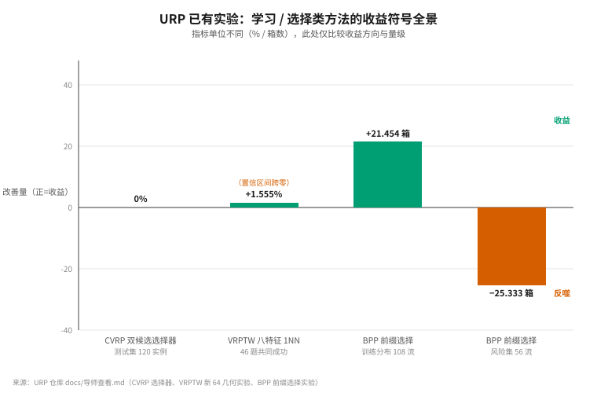
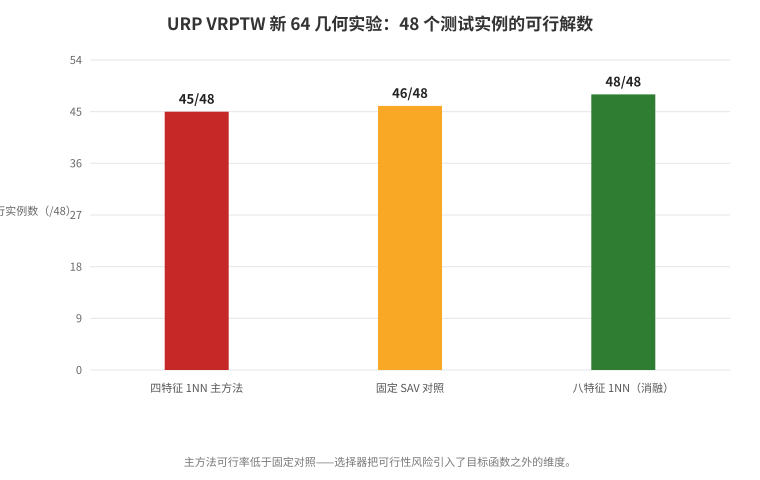
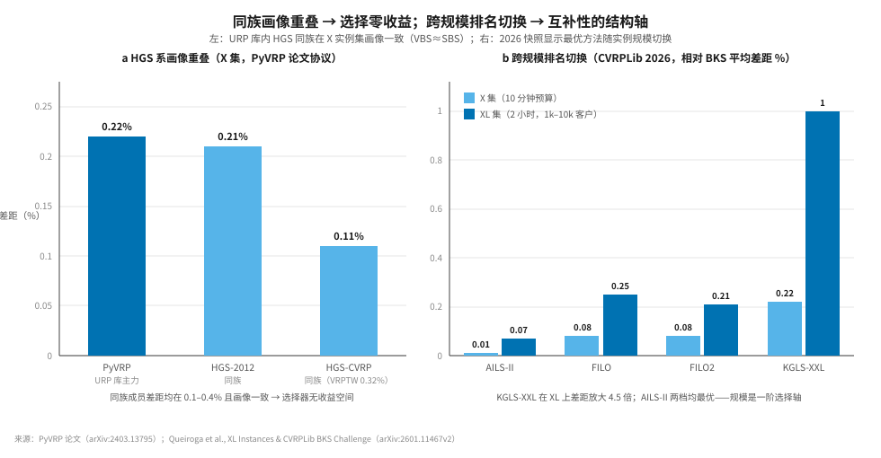
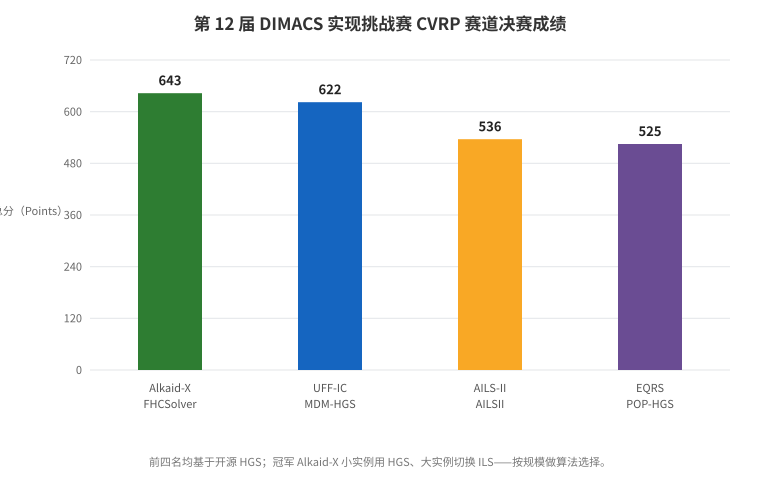
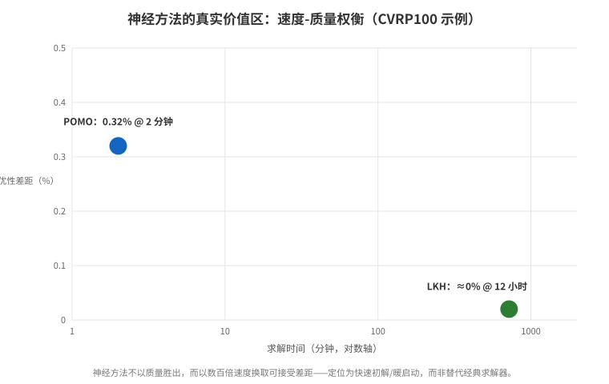
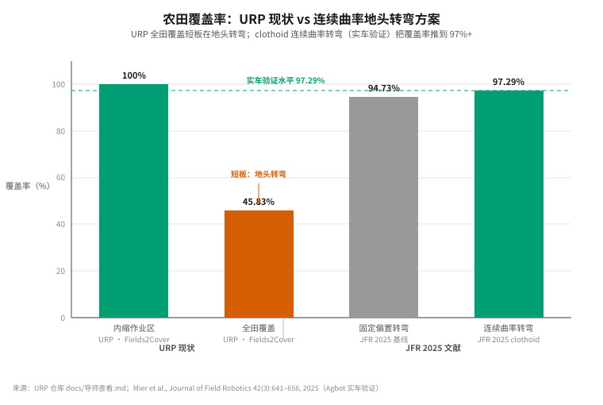
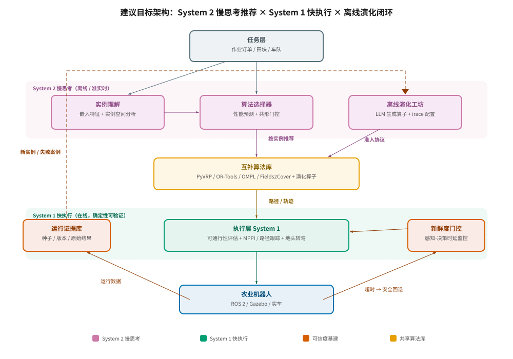
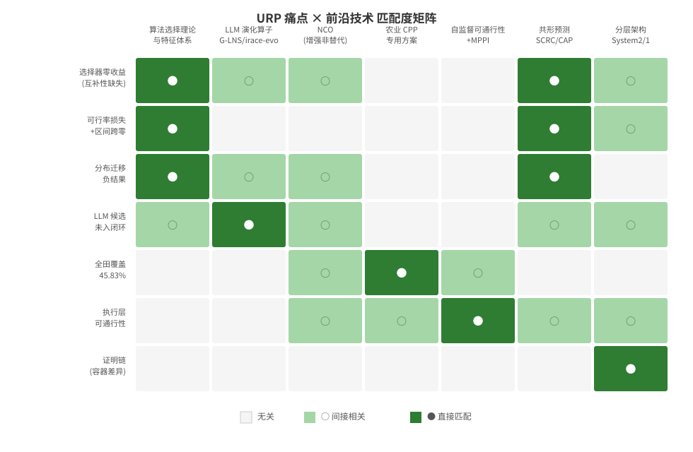

# 面向农业机器人路径规划与决策的前沿技术批判性深度调研报告

——基于 URP 仓库《面向农业机器人的路径规划算法库构建与智能推荐方法研究》现状的痛点诊断与技术映射

## 执行摘要

**核心判断**：URP 当前最值钱的资产不是任何单一算法，而是已经跑通的"算法库 + 真实测量 + 准入协议"科研基建；当前最大的瓶颈是库里成员**性能画像高度重叠**（PyVRP 在 X 实例集上 265/265 可行、问题等权平均参考差距仅 0.341%），导致选择器**理论上就没有可收割的收益空间**([URP README](https://github.com/peakpeng666/URP/blob/main/README.md))。前沿研究给出的答案高度一致：**选择器的收益上限是 VBS−SBS 差距，差距要靠"互补性"造出来，而不是靠更强的选择器**。LLM 自动启发式设计（AHD）在 2026 年 2 月刚刚赢得 CVRPLib 最优已知解竞赛并建立 51 个新 BKS，证明"LLM 演化求解器组件"已具备实战价值([EoH GitHub](https://github.com/FeiLiu36/EOH))；但同一时期的批判性基准研究表明，LLM 演化出的启发式**跨分布泛化很差**，这与 URP 在 BPP 风险集上的负结果互为印证([Sim et al.](https://arxiv.org/abs/2501.11411))。

本报告给出的总路线是：**先用算法选择理论做"互补性审计"（近期），再以 PyVRP 的 destroy/repair 算子为靶点接入 LLM 演化闭环（中期），同时在农业覆盖与执行层直接移植已被实车验证的方案（连续曲率地头转弯、自监督可通行性、MPPI），并用共形预测与新鲜度门控把"决策可信度"做成一等公民**。不建议的方向：端到端神经求解器替代 PyVRP、世界模型/决策 Transformer 直接规划田间轨迹。

---

## 1. URP 项目现状诊断

### 1.1 项目构成与已有资产

URP 是本科生科研训练项目，主线为"面向农业机器人的路径规划算法库构建与智能推荐方法研究"，仓库现有 **28 个注册算法配置，覆盖 5 类问题**（点到点 10、欧氏 CVRP 4、转弯 5、覆盖 4、车队 5），技术栈为 PyVRP、OR-Tools、OMPL、Fields2Cover、ROS 2/Gazebo、Foxglove Bridge、SQLite，LLM 生成侧使用 GLM-5.3([URP README](https://github.com/peakpeng666/URP/blob/main/README.md))。CVRP 主线已积累 **4505 项终态结果**（4316 可行、189 无有效解），PyVRP 在 265 个实例上全部可行，问题等权平均参考差距 **0.341%**——这是一个相当扎实的测量底座([URP README](https://github.com/peakpeng666/URP/blob/main/README.md))。

更难得的是工作约定层面：仓库以 AGENTS.md 形式固化了"区分规则推荐与学习模型、保留种子/版本/原始结果/失败状态、不覆盖冻结档案"的实验纪律([AGENTS.md](https://github.com/peakpeng666/URP/blob/main/AGENTS.md))，并且已有完整的文献链梳理——涵盖 EoH/FunSearch/ReEvo 的生成接口、Hydra/DASH/EoH-S/DreamCoder 的互补建库思想、SH/Hyperband/BOHB 的预算分配方法([综合分析.md](https://github.com/peakpeng666/URP/blob/main/literature/综合分析.md))。《下一阶段.md》提出的四种准入规则（单成员成绩、VBS 增量、实际选择收益、当前策略残差）与五种对照（旧库实际策略、SBS、新成员单独、新库 VBS、新库实际策略），加上"计入完整成本（token、评价、CPU、特征、选择、重训、回退）"的成本观，与学术界 2025—2026 年的最佳实践几乎同构([下一阶段.md](https://github.com/peakpeng666/URP/blob/main/docs/下一阶段.md))。

### 1.2 七条关键痛点（证据链）

尽管基建扎实，仓库自报的证据暴露了七个结构性问题，它们决定了前沿技术该往哪里接。第一，**选择器零收益**：CVRP 双候选选择器在 120 实例（train60/cal30/test30）上，测试集 PyVRP 27 胜 3 平、替代选择 0 次、平均收益为 0([导师查看.md](https://github.com/peakpeng666/URP/blob/main/docs/导师查看.md))。第二，**可行率损失**：VRPTW 新 64 几何实验中，四特征 1NN 主方法可行 45/48，反而低于固定 SAV 对照的 46/48；八特征消融虽 48/48 可行且共同成功 46 题平均相对距离降 1.555%，但置信区间跨零([导师查看.md](https://github.com/peakpeng666/URP/blob/main/docs/导师查看.md))。第三，**分布迁移反噬**：历史 BPP 前缀选择在训练分布 108 流上平均少用 21.454 箱（49/56/3），但在风险集上平均多用 25.333 箱([导师查看.md](https://github.com/peakpeng666/URP/blob/main/docs/导师查看.md))。

第四，**LLM 生成与推荐闭环脱节**：P2 槽位 60 中 43 个完整候选（EOH 24/30、IID 19/30），但校准门控下 32 个非基线推荐全被拒，生成能力尚未转化为库内资产([导师查看.md](https://github.com/peakpeng666/URP/blob/main/docs/导师查看.md))。第五，**全田覆盖短板**：Fields2Cover 内缩作业区覆盖 100%，但全田覆盖仅 45.83%([导师查看.md](https://github.com/peakpeng666/URP/blob/main/docs/导师查看.md))。第六，**执行层证据薄弱**：理想果园 8/8、非理想地面 3/3 的规模偏小，容器环境 warehouse 0/5 与原生 5/5 的执行差异说明证明链不完整（3604 项主机证明链不完整）([导师查看.md](https://github.com/peakpeng666/URP/blob/main/docs/导师查看.md))。第七，多车协同仍停留在串行基线。这七条痛点构成后文技术映射的行坐标。

---

## 2. 调研方法

本调研以 URP 仓库（默认分支 main，最新提交 9eaf9eb，2026-10-20）为事实锚点，开展了 **12 轮以上联网检索**，覆盖六个方向：算法选择与实例空间分析理论；神经组合优化（NCO）及其批判文献；LLM 自动启发式设计（AHD）；农业覆盖路径规划与农业路由问题（ARP）；田间机器人运动规划与可通行性；决策可信度（共形预测、拒判、具身基准）。检索优先采用期刊/会议原文（INFORMS、ACM、AAAI、ICML/TMLR、JFR、Computers and Electronics in Agriculture、Smart Agricultural Technology 等）与官方代码仓，博客与二手综述仅作线索，不作为关键证据。

批判性原则贯穿全文：凡学习方法声称的优势，均同时给出反方证据；凡建议 URP 采纳的技术，均对照其现有实验纪律（种子留存、准入协议、成本核算）检验可操作性。文中所有数据均可沿行内链接回溯。

---

## 3. 算法选择与推荐：为什么"零收益"，以及怎么办

### 3.1 VBS−SBS 差距：选择收益的上限审计

算法选择理论中，单实例最优选择的上界是 **VBS（Virtual Best Solver）**，固定单算法的基线是 **SBS（Single Best Solver）**，选择器能收割的最大期望收益就是 VBS−SBS 差距；而 ASlib 基准库的系统性研究表明，多数场景下大量求解器高度相关、对 VBS 的边际贡献极小，前向选择后只需很少几个互补求解器([ASlib](http://www.cs.uwyo.edu/~larsko/papers/bischl_aslib__2016.pdf))。URP 的 CVRP 库恰好处于"VBS≈SBS"象限：PyVRP 是 2021 年第 12 届 DIMACS 实现挑战赛 VRPTW 赛道第一名算法的精炼版，在 X 实例集上平均差距仅 **0.22%**，与同族 HGS-2012 的 0.21%、HGS-CVRP 的 0.11% 几乎重叠([PyVRP 论文](https://arxiv.org/abs/2403.13795))。在这种性能画像下，任何选择器在欧氏 CVRP 标准分布上的期望收益都趋近于零——URP 实测"替代选择 0 次、平均收益为 0"不是选择器失败，而是**互补性缺失的必然结果**。

正面证据来自顶级赛事本身：DIMACS CVRP 赛道冠军 Alkaid-X 的 FHCSolver 正是**按实例规模做算法切换**——小实例用 HGS、大实例切换迭代局部搜索（ILS），以 643 分夺魁；前四名（UFF-IC 的 MDM-HGS 622 分、AILS-II 536 分、EQRS 的 POP-HGS 525 分）全部基于开源 HGS 改造([DIMACS 结果页](https://dimacs.rutgers.edu/programs/implementation-challenges/vehicle-routing/implementation-challenge-vehicle-routing/results), [DIMACS 新闻](https://dimacs.rutgers.edu/news/news-details/the-12th-dimacs-implementation-challenge-vrp))。**启示是双重的**：其一，选择发生在一阶结构轴（规模、几何、约束）上才有肉；其二，URP 的第一件事应是给现有库做"互补性审计"——按实例切片（规模×几何×约束）计算 VBS−SBS 差距，差距显著为正的切片才是选择器的战场，差距为零的切片应果断放弃选择、转向生成。

### 3.2 实例特征体系：从手工特征到嵌入表示

URP 当前用人工设计的 4/8 个几何特征驱动 1NN 选择器。2026 年的 ZeroFolio 提供了一条更便宜的路线：**把实例文件当纯文本读入，用预训练嵌入模型编码，再做加权 kNN 选择**，全程零领域知识；在 11 个 ASlib 场景（SAT、MaxSAT、QBF、ASP、CSP、MIP、图问题）中，该流水线以单一固定配置在 10/11 个场景击败基于手工特征的随机森林，双种子投票后 11/11 全胜([ZeroFolio](https://arxiv.org/abs/2604.19753))。其消融显示关键设计是逆距离加权、行打乱序列化与曼哈顿距离。对 URP 而言，这意味着特征工程可以从"手工设计—消融验证"循环切换为"嵌入 + 手工特征软投票融合"，且嵌入路线天然覆盖 CVRPLib/Fields2Cover 的文本实例格式。

手工特征并非要抛弃，而是要**体系化**。ASlib 的经验是多数场景中只有极少数特征真正驱动选择([ASlib](http://www.cs.uwyo.edu/~larsko/papers/bischl_aslib__2016.pdf))；实例空间分析（ISA）进一步把"特征空间中的获胜区域"显式画出来，MOSAIC 等工作正是借助 ISA 思想让启发式特化到实例空间的具体区域([MOSAIC](https://arxiv.org/abs/2608.07544))。建议 URP 将特征栈分三层：嵌入层（ZeroFolio 式，泛化兜底）、结构层（规模/密度/需求分布/几何矩）、领域层（田块形状指数、障碍物占比、行间宽度），并用 SIFTED 式筛选把每层的冗余特征砍掉，使选择器在低维、可解释的空间里工作。

### 3.3 可行性与多目标选择：VRPTW 教训的正面解读

URP 的 VRPTW 实验里，主方法 45/48 可行、固定 SAV 对照 46/48 可行——选择器引入的微小距离收益伴随着**可行性风险敞口**，且 1.555% 的平均改善区间跨零([导师查看.md](https://github.com/peakpeng666/URP/blob/main/docs/导师查看.md))。这暴露的是目标设计问题：选择目标只含距离，不含"不可行概率"。学术界对此的成熟处理是把可行性与成本写成联合风险度量，再以风险可调的方式做选择性预测；选择性共形风险控制（SCRC）正是两阶段方案——第一阶段决定哪些样本**值得给出预测**（选择控制），第二阶段只对被接受的样本构造满足风险上界的预测集([SCRC](https://arxiv.org/abs/2512.12844))。

统计层面还有两点必须修。其一，随机求解器上"用同一批数据既选又估"会系统性高估选择收益，正确做法是嵌套重采样或留出协议——URP 已有的 train/cal/test 三段划分方向正确，应坚持并对 VBS 增量采用**仅校准集估计**；其二，"区间跨零"的结果应报告效应量与配对检验功效，而非只报均值。这两点与 URP 下一阶段计划中的"五种对照 + 完整成本核算"完全兼容([下一阶段.md](https://github.com/peakpeng666/URP/blob/main/docs/下一阶段.md))，缺的只是把可行性风险写进目标函数。

---

## 4. 互补性驱动的算法库扩张：LLM 自动启发式设计

### 4.1 谱系与里程碑：从 FunSearch 到 CVRPLib 冠军

LLM 自动启发式设计（AHD）的主线已经清晰：FunSearch 以"LLM + 评估器"的岛屿模型演化程序，在在线装箱等问题上超越人类基线，登上 Nature([FunSearch](https://pmc.ncbi.nlm.nih.gov/articles/PMC10794145/))；EoH 同时演化"思想（thought）+ 代码"，获 ICML 2024 Oral([EoH](https://arxiv.org/abs/2401.02051))；AlphaEvolve 把演化对象扩展到完整代码库，采用 MAP-Elites 与岛屿模型维护多样性([AlphaEvolve](https://arxiv.org/abs/2506.13131))；ShinkaEvolve 用父代采样、代码新颖性拒绝采样与 bandit 式 LLM 集成选择，把样本效率提升到 **150 个样本即刷新圆堆积 SOTA**([ShinkaEvolve](https://arxiv.org/abs/2509.19349))。平台侧的 LLM4AD 已把 EoH、MEoH、FunSearch、ReEvo、MCTS-AHD、LLaMEA、EoH-S 等方法统一到同一框架([LLM4AD](https://github.com/Optima-CityU/LLM4AD))。

与 URP 最相关的两个里程碑发生在 2026 年。其一，**EoH 赢得 CVRPLib 最优已知解（BKS）竞赛**：OptVerse-CityU 队以 AILS-II 为主搜索引擎，用 EoH 自动演化其接受准则、扰动控制与 ruin 算子，配合 HGS-CVRP、FILO2 组合求解，在 100 个 XL 实例上建立 **51 个新 BKS**，全程约 42,600 CPU-天([XL 实例与 BKS 竞赛](https://arxiv.org/abs/2601.11467), [CityU Optima 新闻](https://optima.cs.cityu.edu.hk/))。其二，**EoH-S 把设计对象从"单一最优启发式"改为"互补启发式集合"**：提出自动化启发式集合设计（AHSD），证明其目标函数单调且超模，配合互补种群管理与模因搜索，在在线装箱、TSP、CVRP 上较 SOTA AHD 方法最高提升 60%([EoH-S](https://arxiv.org/abs/2508.03082))。EoH-S 的问题陈述——"让每个实例至少被集合中一个成员服务好"——与 URP 的准入协议（VBS 增量、残差）在数学上是同一件事，**可以直接把 EoH-S 的互补性度量翻译为 URP 的第四准入规则（当前策略残差）的可计算形式**。

### 4.2 批判性证据：跨分布泛化崩塌

必须泼冷水。Sim、Renau 与 Hart 对装箱问题做了首个严格的大范围基准研究：多数 LLM 演化启发式**只在实例空间的狭小区域内获胜，跨基准泛化明显差于简单传统启发式**，并警告"特化启发式的收益必须与其可观的生成成本一起权衡"([Beyond the Hype](https://arxiv.org/abs/2501.11411))。后续独立分析确认 FunSearch 系装箱启发式在其训练分布（特定参数的 Uniform/Weibull）之外迅速退化([LLM-BPP 深度研究](https://arxiv.org/abs/2510.27353))。MOSAIC 把这一失败归因于"在固定小训练集上优化平均性能 + 标量反馈无方向信息"，并给出对抗式共演化（启发式与实例生成器互为对手）的解法([MOSAIC](https://arxiv.org/abs/2608.07544))。

这与 URP 的 BPP 负结果完全同构：前缀选择在训练分布少用 21.454 箱、风险集反噬 25.333 箱([导师查看.md](https://github.com/peakpeng666/URP/blob/main/docs/导师查看.md))。**结论：LLM 演化出的成员必须以"部署分布"为评价基准，且入库测试必须包含分布外切片**；URP 下一阶段计划中的"按底本/田块分组隔离"正是这道防线，建议再加一条硬规则——任何演化候选在至少一个 OOD 切片上不得显著劣于基线，否则一票否决。

### 4.3 演化靶点工程：从"完整启发式"到"求解器组件"

泛化崩塌的教训改变了演化对象的选择。2026 年的趋势是不再让 LLM 生成端到端求解器，而是生成**成熟求解器内部的组件**：G-LNS 让 LLM 协同演化 LNS 的 destroy 与 repair 算子对（以 ALNS 自适应打分作为适应度信号），在 CVRPLib Set F 上把最优性差距从 EoH-S 的 40.1% 压到 15.9%，在 TSPLib 上保持 2.8% 的低差距([G-LNS](https://arxiv.org/abs/2602.08253))；PyVRP+ 直接把"LLM 驱动的元认知启发式演化"做到 HGS 求解器（即 PyVRP 内核）上([PyVRP+](https://arxiv.org/abs/2604.07872))；irace-evo 把自动配置工具 irace 扩展到"参数 + 代码"联合空间，采用 Always-From-Original 原则（每个变体都从原始代码重新生成、防止漂移累积），在 VSBPP 的 CMSA 算法上发现了多个超越 SOTA 的放置启发式，**总 LLM 成本低于 2 欧元**([irace-evo](https://arxiv.org/abs/2511.14794))。

对 URP 这是决定性好消息：PyVRP 本身就是 HGS/ALNS 体系，其 destroy/repair 算子、接受准则、多样性管理都有清晰函数边界，**正是 G-LNS/PyVRP+/irace-evo 三类工作的标准靶点**；GLM-5.3 生成管线和 P2 槽位评价协议可以直接复用，只需把演化目标从"生成完整启发式"改为"为 PyVRP 生成一个在特定实例切片上击败默认算子的 destroy/repair 对"。准入判据用仓库已有的 VBS 增量 + 残差规则，多样性维护借鉴 AlphaEvolve 的 MAP-Elites 岛屿([AlphaEvolve](https://arxiv.org/abs/2506.13131))，成本上限参照 irace-evo 的 2 欧元量级做预算门([irace-evo](https://arxiv.org/abs/2511.14794))。这样 LLM 生成不再是游离的 P2 实验，而是闭环里可准入、可回退、可计成本的库成员生产线。

---

## 5. 神经组合优化与决策模型：能用什么，不能指望什么

### 5.1 谱系速览

NCO 五年间的代表线：POMO 在 CVRP100 上达到对 LKH 平均 **0.32%** 的差距而推理只需约 2 分钟（LKH 约 12 小时）([制造业 L2O 综述](https://ietresearch.onlinelibrary.wiley.com/doi/10.1049/cim2.12072))；RouteFinder 把 48 个 VRP 变体统一到属性化通用问题，用全局属性嵌入 + 高效适配器层（EAL）做变体间迁移，是"VRP 基础模型"方向目前最完整的实现([RouteFinder](https://arxiv.org/abs/2406.15007))；改进型路线上，NLNS 用注意力网络学习 LNS 的修复算子([NLNS](https://arxiv.org/abs/1911.09539))，NDSS 进一步学习"解构"策略([NDSS](https://arxiv.org/abs/2501.03715))。

这条谱系对 URP 的可迁移点不在模型结构，而在**接口形态**：构造式（POMO 类）输出整解、改进式（NLNS/NDSS 类）输出算子、基础模型式（RouteFinder 类）输出跨变体共享表示。URP 的库注册体系（28 配置、5 类问题）天然适合接入"算子级"产物——改进式方法与 PyVRP 的 LNS 内核同构，接入成本最低；构造式方法只能作为独立成员参与选择，而这恰好会撞上第 3.1 节的互补性门槛([URP README](https://github.com/peakpeng666/URP/blob/main/README.md))。

### 5.2 批判：位置在"增强"，不在"替代"

批判证据同样扎实。Garmendia、Ceberio 与 Mendiburu 的 ACM TELO 批判性综述系统比较后认定：神经方法在**性能、计算成本、可迁移性与可复用性**四个维度相对精确算法、启发式与元启发式的优势都是有限的([A Critical View](https://dl.acm.org/doi/full/10.1145/3647644))；JMLR 的图神经网络组合优化综述记录了 Böther 等人无法复现 GNN+树搜索方法、甚至随机权重表现相近的失败案例([JMLR 综述](https://jmlr.org/papers/volume24/21-0449/21-0449.pdf))。即便在 NCO 内部，质量冠军仍是经典栈：RouteFinder 论文表格中 HGS-PyVRP 的质量仍居最优([RouteFinder](https://arxiv.org/abs/2406.15007))；DIMACS 前四名无一是纯神经方法([DIMACS 结果页](https://dimacs.rutgers.edu/programs/implementation-challenges/vehicle-routing/implementation-challenge-vehicle-routing/results))。

**正确定位是"增强"**：神经构造器给出秒级初解暖启动 PyVRP；学习式 destroy/repair（NLNS/NDSS 路线）作为库内新算子参与准入；学习分解（learning-to-delegate）把大实例切成 PyVRP 可吞的子问题([L2D](https://arxiv.org/abs/2107.04139))。对 URP 的硬建议：不引入端到端神经求解器作为库成员（质量打不过 PyVRP 且引入不可解释的失败模式），但可以把 POMO 类模型作为**快速可行解生成器**用于大规模实例的时间受限场景——前提是先在小规模上验证其输出与 PyVRP 的互补性切片确实存在。

### 5.3 决策模型的边界：RL、世界模型与 VLA

决策模型层面要区分三类。其一是**求解时逐状态决策**：HeurAgenix 让 LLM 在求解过程中按状态选择低层启发式([HeurAgenix](https://arxiv.org/abs/2506.15196))，InstSpecHH 做"实例特定"的启发式生成与选择([InstSpecHH](https://arxiv.org/abs/2506.00490))——这类"在线选择"比 URP 当前的"求解前一次性选择"更细，是中期可探索的方向。其二是**具身任务规划**：AFL 用生成/评判/修订/错误分析四个 LLM 智能体协作解 VRP，把可行性推到接近 100%([AFL](https://proceedings.iclr.cc/paper_files/paper/2026/file/b9c91701ff28d480f186e4643e71ad11-Paper-Conference.pdf))；VLA 模型（OpenVLA 7B，29 任务上超 RT-2-X 16.5 个百分点）证明了端到端视觉-动作泛化的进展([OpenVLA](https://arxiv.org/abs/2406.09246))。其三是**必须警惕的边界**：EmbodiedBench 显示多模态大模型在动态具身场景的成功率显著下滑([EmbodiedBench](https://arxiv.org/abs/2502.09560))，而 2026 年的世界模型研究表明，用目标偏置的离线轨迹训练的世界模型存在组合泛化失败([World Model Generalization](https://arxiv.org/html/2610.26844))。

对 URP 的含义：System 2（慢思考层）可以用 LLM 做任务解析、实例描述与推荐解释（AFL 式多智能体做"推荐 + 校验"）；System 1（快执行层）必须是确定性、可验证的控制器；**不要用世界模型或决策 Transformer 替代执行层规划器**——农业场景的安全约束（作物、田界、人）不允许黑箱策略直接闭环。

---

## 6. 农业场景专用技术链

### 6.1 覆盖路径规划：标准化评估与连续曲率地头

URP 全田覆盖 45.83% 的短板在地头转弯([导师查看.md](https://github.com/peakpeng666/URP/blob/main/docs/导师查看.md))。文献给出了直接可移植的答案：Mier 等人的**连续曲率地头覆盖规划**用 clothoid（回旋曲线）构造三类凹凸角转弯，在 Nilsson–Zhou 基准上把三地头轨道的平均覆盖率从固定偏置法的 **94.73% 提到 97.29%**，且用 Agbot 实车验证机器人不越界([JFR 2025](https://onlinelibrary.wiley.com/doi/full/10.1002/rob.22489))。评估基建上，Fields2Benchmark 提供 **350 块真实田块**（含非凸与田内障碍）、16 个算法、8 个目标函数，并把 CPP 拆成田块分解、地头生成、作业行生成、路径规划、轨迹规划五个可独立评测的模块([Fields2Benchmark](https://www.sciencedirect.com/science/article/pii/S2772375525003880))——URP 应把评估从自制少量田块迁移到该基准，彻底解决"证明链不完整"问题中的输入侧。

成本函数侧，Soil2Cover 把 SoilFlex 土壤力学模型嵌入覆盖路由，1000 块田上的测试显示路线长度最多省 4–6%、地头土壤压实最多降 **30%**，其代码将随 Fields2Cover 第三版发布([Soil2Cover](https://link.springer.com/article/10.1007/s11119-025-10250-4))。这提示 URP：覆盖问题的"目标函数"本身就是可选、可推荐的对象——距离最短、压实最小、转弯最少对应不同最优路线，**农业场景天然是多目标算法选择的用武之地**。

### 6.2 农业路由问题谱系与"算法选择"的直接先例

农业路由问题（ARP）有一条被 URP 低估的谱系：Seyyedhasani 与 Dvorak 用 VRP 建模多机田间作业以压缩完工时间，进而用动态多仓库 VRP 做作业中动态重路由([动态重路由](https://doi.org/10.1016/j.biosystemseng.2018.04.003))；Utamima 等的 ENDA 用演化式邻域发现求解多田块农业路由([ENDA](https://doi.org/10.1007/s10479-022-04685-5))。最关键的是 Seyyedhasani、Dvorak 与 Roemmele 2019 年的论文**《基于田块形状与车队规模的覆盖规划路由算法选择》**——标题即 URP 的课题，它证明在农业覆盖场景里"按田块形状与车队规模选算法"本身就能产生显著收益([Seyyedhasani 2019](https://doi.org/10.1016/j.compag.2018.12.002))。

这条先例给 URP 两个战略信号：其一，算法选择在农业领域的"结构轴"（田块形状、车队规模、作业模式）上是被验证有效益的，这与第 3.1 节"选择发生在一阶结构轴上"的判断互相印证；其二，URP 的车队/覆盖两条主线可以合并成一个统一叙事——**"农业路径规划问题的实例结构 → 算法/参数/目标函数推荐"**，比欧氏 CVRP 上的微调式选择更有论文价值。

### 6.3 执行层：果园导航、可通行性与风险感知控制

执行层的前沿同样成熟。果园 GNSS 拒止环境下，VIO-MPC 框架用低成本视觉惯性里程计 + 模型预测控制做地头转弯，香蕉园实车测试达到 **0.014 m 平均径向误差、1.8° 航向误差**([VIO-MPC](https://doi.org/10.1016/j.atech.2025.101373))；多模态融合框架（相机 + 2D LiDAR + GNSS/IMU 的 EKF）把定位平均误差从 3.6 cm 压到 0.78 cm，路径跟踪平均误差 11.66 cm，全部以 ROS 节点模块化实现([果园导航框架](https://link.springer.com/article/10.1007/s12555-026-00103-9))。可通行性侧，WayFAST/WayFASTER 系列为田间机器人提供自监督的可通行性预测([WayFASTER](https://arxiv.org/abs/2402.00683))，EVORA 用深度证据学习同时量化 aleatoric 与 epistemic 不确定性，并把风险感知规划器闭环([EVORA](https://arxiv.org/abs/2311.06234))。

对 URP 的映射是直接的：非理想地面 3/3 的样本量撑不起任何统计结论，应把执行层评测改成"可通行性预测误差 + 风险事件率"的过程指标，用自监督信号（打滑、振动、跟踪残差）替代人工标注；控制器选型上 MPPI/MPC 优先于端到端 DRL——前者可嵌入代价约束且行为可解释，后者缺安全保证。地头转弯同时是覆盖问题与执行问题的接口：第 6.1 节的 clothoid 规划负责几何，本节的 MPC 负责跟踪，二者应在统一的地头转弯基准上联合评测。

---

## 7. 可信度与决策安全

### 7.1 共形预测的升级路径

URP 已用共形风险控制（CRC）做校准门控，结果是 32 个非基线推荐全被拒([导师查看.md](https://github.com/peakpeng666/URP/blob/main/docs/导师查看.md))。门控"全拒"未必是门控太严，更可能是候选与基线无互补（第 3.1 节）叠加**预测目标不含可行性**（第 3.3 节）。升级路径有三级：第一级，把门控目标从"性能不劣于基线"改为"可行性风险 + 性能风险"双约束；第二级，采用 SCRC 两阶段结构——先选"值得预测的实例"，再对入选实例做风险控制的预测集，其对称选择规则可保持交换性、保住共形保证([SCRC](https://arxiv.org/abs/2512.12844))；第三级，对在线场景（田间实时推荐）引入自适应拒判阈值，以覆盖率与风险的显式权衡取代固定阈值。

必须记住共形保证的数学前提：交换性。一旦实例分布漂移（新田块、新机型、新作物品系），边缘覆盖保证失效——这正是 BPP 风险集反噬的统计学解释。因此共形门控之前应前置**分布外检测**：用第 3.2 节的嵌入表示做新颖度打分，嵌入距离超阈值的实例直接回退到 SBS（PyVRP 默认配置），不进入选择链路。

### 7.2 分布迁移防御的工程化

把 7.1 收束成工程清单：其一，所有学习类组件（选择器、嵌入、演化算子）入库时必须附带**适用域声明**（训练分布的特征范围），运行期检测超出声明域即降级；其二，运行证据库记录每次推荐的特征快照与事后实际收益，定期重估 VBS−SBS 差距的漂移；其三，演化生产线（第 4.3 节）的评价集每季度用新收集的田间实例刷新，防止演化方向与真实分布脱节——MOSAIC 的对抗式实例生成可作为刷新机制的主动版([MOSAIC](https://arxiv.org/abs/2608.07544))。

这套防御的落地成本很低：嵌入新颖度打分是第 3.2 节特征栈的副产品，适用域声明只是一段随成员注册的元数据，漂移重估复用仓库已有的 SQLite 原始结果档案([AGENTS.md](https://github.com/peakpeng666/URP/blob/main/AGENTS.md))。真正需要新增的只有两条流水线纪律——"刷新评价集"与"漂移触发再训练"，建议写入 AGENTS.md 作为与"不覆盖冻结档案"并列的第七条约定。

---

## 8. 系统架构改造建议

综合前文，建议的目标架构为**"System 2 慢思考推荐 × System 1 快执行 × 离线演化闭环"**三层结构，如下图。

- **任务层**：作业订单、田块、车队进入后先做实例理解（嵌入特征 + 实例空间分析，第 3.2 节）。
- **System 2（离线/准实时）**：算法选择器基于性能预测 + 共形门控（第 7 节）给出"算法 + 参数 + 目标函数"三元组推荐；离线演化工坊以 PyVRP 的 destroy/repair 算子为靶点，用 LLM（GLM-5.3 或低成本模型，预算参照 irace-evo 的 2 欧元量级）持续生产候选组件，准入走仓库已有的四规则协议([下一阶段.md](https://github.com/peakpeng666/URP/blob/main/docs/下一阶段.md))。
- **算法库**：PyVRP/OR-Tools/OMPL/Fields2Cover 为主体，演化算子作为可回退的插件成员；互补算法库的定义从"算法列表"升级为"（组件 × 参数 × 适用域）三元组"。
- **System 1（在线）**：可通行性评估 + MPPI/路径跟踪 + clothoid 地头转弯，全程确定性可验证；新鲜度门控监控感知-决策时延，超时即安全回退（EmbodiedBench 的教训([EmbodiedBench](https://arxiv.org/abs/2502.09560))）。
- **可信度基建**：运行证据库（种子/版本/原始结果）回流演化工坊，形成"新实例/失败案例 → 再演化"的闭环；容器与原生执行差异必须收敛为单一受控环境——证明链不完整（3604 项）的问题不解，任何学习组件的结果都无法归档([导师查看.md](https://github.com/peakpeng666/URP/blob/main/docs/导师查看.md))。

痛点与技术的整体匹配关系如下热力图：**算法选择理论、共形预测与分层架构是覆盖面最广的三族技术**；农业 CPP 专用方案对全田覆盖痛点为唯一直接匹配；LLM 演化算子对"LLM 候选未入闭环"为唯一直接匹配。

---

## 9. 分阶段路线图

下表把建议落到三个学期尺度，并与 URP《下一阶段.md》的准入协议、成本核算逐条对接([下一阶段.md](https://github.com/peakpeng666/URP/blob/main/docs/下一阶段.md))。

| 阶段 | 目标 | 关键动作 | 验收判据 | 主要依据 |
|---|---|---|---|---|
| 近期（1 学期） | **互补性审计 + 特征升级** | 按规模×几何×约束切片计算现有库 VBS−SBS 差距；接入嵌入特征与手工特征软投票；选择目标加入可行性风险；覆盖评估迁移到 Fields2Benchmark 的 350 田 | 产出各切片的差距图谱；明确"做选择"与"做生成"的切片边界；覆盖率指标与文献可比 | ([ZeroFolio](https://arxiv.org/abs/2604.19753))、([Fields2Benchmark](https://www.sciencedirect.com/science/article/pii/S2772375525003880)) |
| 中期（1–2 学期） | **LLM 演化闭环 + 地头转弯 + 门控升级** | 以 PyVRP destroy/repair 算子为靶点跑通 G-LNS/irace-evo 式演化（GLM-5.3，预算门）；互补准入采用 EoH-S 度量；移植 clothoid 地头转弯；门控升级为 SCRC 两阶段 + OOD 前置 | 至少 1 个演化算子通过四规则准入并在一切片上产生稳定净收益；全田覆盖率向 97% 文献水平靠拢；风险集不再出现反噬 | ([G-LNS](https://arxiv.org/abs/2602.08253))、([irace-evo](https://arxiv.org/abs/2511.14794))、([EoH-S](https://arxiv.org/abs/2508.03082))、([JFR 地头转弯](https://onlinelibrary.wiley.com/doi/full/10.1002/rob.22489)) |
| 远期（2 学期+） | **执行层闭环 + 多机协同** | 自监督可通行性 + MPPI 控制器在 Gazebo/实车闭环；多机作业引入 ENDA/动态重路由；System2 推荐层接 AFL 式校验智能体；形成"农业路径规划实例结构 → 推荐"的完整论文叙事 | 执行层有过程指标（可通行性误差、风险事件率）的统计显著证据；多机对照串行基线有净收益 | ([WayFASTER](https://arxiv.org/abs/2402.00683))、([EVORA](https://arxiv.org/abs/2311.06234))、([ENDA](https://doi.org/10.1007/s10479-022-04685-5))、([AFL](https://proceedings.iclr.cc/paper_files/paper/2026/file/b9c91701ff28d480f186e4643e71ad11-Paper-Conference.pdf)) |

每一阶段的"继续推进判据"沿用仓库既定原则：固定预算新实例上的稳定净收益 + 消融定位([下一阶段.md](https://github.com/peakpeng666/URP/blob/main/docs/下一阶段.md))。特别地，近期阶段的互补性审计是**全路线的总开关**：若审计发现某些切片存在正差距，选择器直接复活；若全库切片差距均为零，则证明当前库结构已到顶，全部资源转向演化生产线。

## 10. 风险清单与反方观点

第一，**嵌入选择器可能在小样本上不稳定**。ZeroFolio 的 11 场景胜利建立在 ASlib 的成数百实例规模上([ZeroFolio](https://arxiv.org/abs/2604.19753))，URP 单切片实例数偏小，嵌入 kNN 可能退化；缓解办法是软投票融合而非替换手工特征。第二，**LLM 演化的成本-收益可能不划算**。Sim 等的警告与 URP 自己的 BPP 反噬是同源证据([Beyond the Hype](https://arxiv.org/abs/2501.11411))，irace-evo 的 2 欧元成本是在 VSBPP 单一函数靶点上取得的([irace-evo](https://arxiv.org/abs/2511.14794))，PyVRP 靶点更复杂，预算门必须硬约束。第三，**clothoid 地头转弯的 97.29% 是三轨道地头、特定机型的结果**([JFR 地头转弯](https://onlinelibrary.wiley.com/doi/full/10.1002/rob.22489))，URP 田块分布不同时收益会缩水，需先在 Fields2Benchmark 上复测再实车。第四，**共形保证在漂移下失效**是数学事实而非工程瑕疵，OOD 前置检测一旦漏检，SCRC 的保证随之失效。第五，**多智能体 LLM 框架（AFL 类）的可行性来自校验循环的算力堆叠**，本科项目的 token 预算下应只用其"生成—校验"思想，不宜复制四智能体全架构([AFL](https://proceedings.iclr.cc/paper_files/paper/2026/file/b9c91701ff28d480f186e4643e71ad11-Paper-Conference.pdf))。

最后一条元风险：**不要把 NCO 的论文指标当成工程指标**。Garmendia 等的批判、JMLR 综述记录的复现失败、DIMACS 的名次共同说明，经典求解器在可见将来仍是质量锚点([A Critical View](https://dl.acm.org/doi/full/10.1145/3647644), [JMLR 综述](https://jmlr.org/papers/volume24/21-0449/21-0449.pdf), [DIMACS 结果页](https://dimacs.rutgers.edu/programs/implementation-challenges/vehicle-routing/implementation-challenge-vehicle-routing/results))。URP 的差异化贡献不应是"再造一个神经求解器"，而是**在农业真实分布上，把"测量—推荐—演化—准入—执行"做成可复现的闭环**——这恰好是前沿文献普遍缺失、而 URP 基建已经领先的部分。

---

*本报告为科研调研性质的综合分析，所涉方法建议需在受控实验环境中验证后再投入实际农业作业；不构成工程实施或投资依据。*